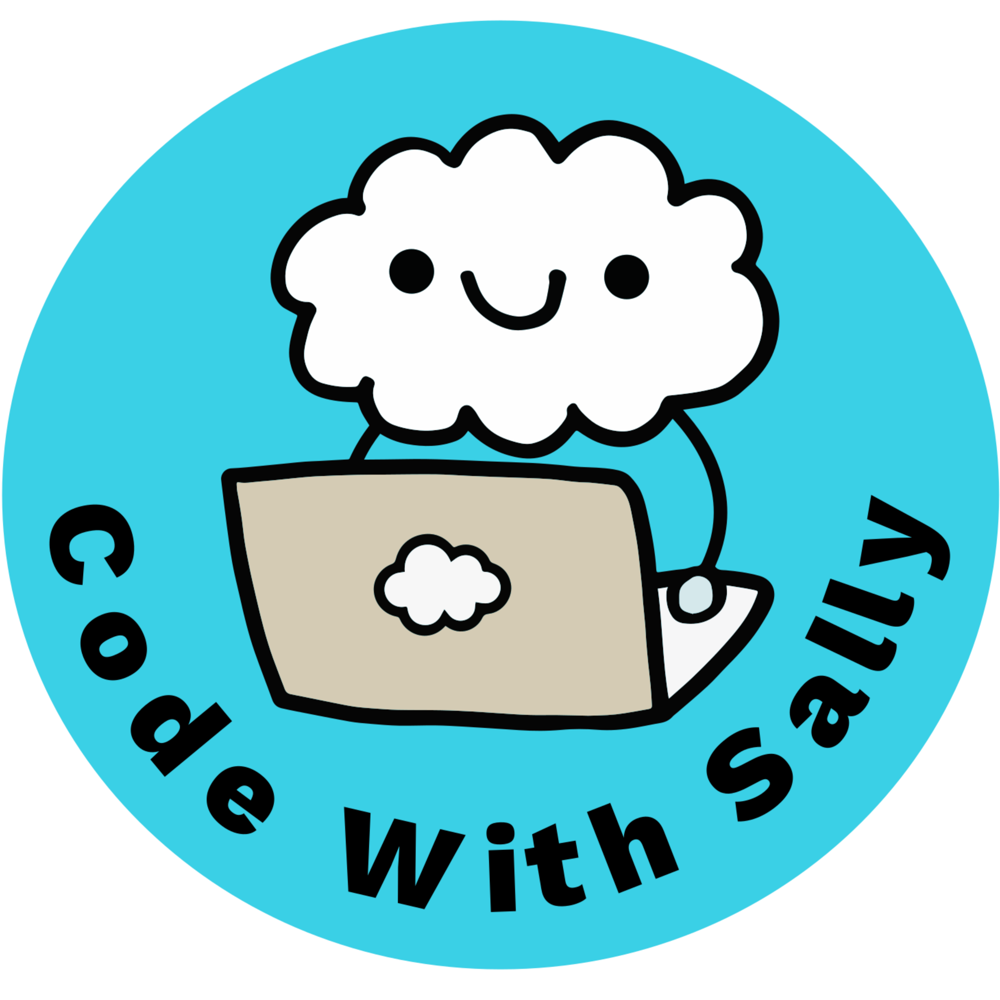
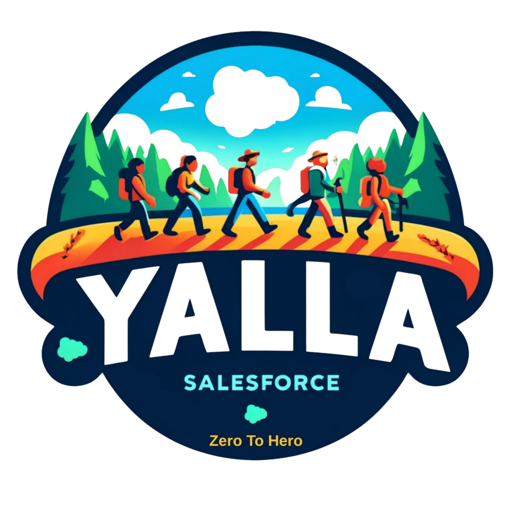

<!-- ============================================================= -->
<!-- LOGOS: put the two image files in an assets/ folder next to this README. -->
<!-- ============================================================= -->

<p align="center">
  
  &nbsp;&nbsp;&nbsp;&nbsp;
  
</p>

<h1 align="center">AIforce Unpacked: The Salesforce Headless Toolkit in Action</h1>

<p align="center">
  <strong>North Africa Dreamin' 2026 · Casablanca</strong><br/>
  Presented by <strong>Sally ElGhoul</strong> (Code With Sally) &amp; <strong>Bassem Ismaiel</strong> (Yalla Salesforce)
</p>

---

## 👋 Welcome

Headless 360 has a new name: **AIforce**. It's powered by the **Headless Toolkit**: APIs, MCPs, AI Skills, Plugins, Widgets (HXL), Identity and Observability.

This page has every link from our session, grouped the same way we walked through the toolkit. Bookmark it: we'll add the **slides (PDF)** here after the event.

> **Coming soon to this page:** 📄 Slides (PDF)

---

## 🧰 Session resources

### 1. APIs
Salesforce APIs have been here all along, and the MCP tools call them underneath.

- **Trailhead: Quick Start: Connect Postman to Salesforce**
  👉 https://trailhead.salesforce.com/content/learn/projects/quick-start-connect-postman-to-salesforce

### 2. MCPs (Salesforce Hosted MCP Servers)
Standard servers you turn on, and custom servers you build from Flows, Apex, prompt templates and more.

- **Hosted MCP Servers overview**
  👉 https://developer.salesforce.com/docs/platform/hosted-mcp-servers/guide/hosted-mcp-servers-overview.html
- **Headless 360 MCP** (discover, describe, dispatch)
  👉 https://developer.salesforce.com/docs/platform/hosted-mcp-servers/guide/headless-360-mcp.html
- **Servers reference** (every standard server and its tools)
  👉 https://developer.salesforce.com/docs/platform/hosted-mcp-servers/guide/servers-reference.html

### 3. AI Skills
Reusable instructions that teach any coding agent how to build on Salesforce the right way.

- **forcedotcom/sf-skills on GitHub** (200+ skills)
  👉 https://github.com/forcedotcom/sf-skills

```bash
npx skills add forcedotcom/sf-skills
```

### 4. Plugins
The Salesforce development plugin for Claude Code bundles about 40 skills, 3 MCP servers, agents, hooks and commands in one install.

- **Headless development with skills and a Claude Code plugin** (Salesforce Developers blog)
  👉 https://developer.salesforce.com/blogs/2026/08/headless-development-with-skills-and-a-claude-code-plugin

**Prerequisites:** Claude Code, Node.js LTS, Salesforce CLI, Python 3.8+

```bash
sf org login web --alias my-org --set-default
/plugin install salesforce-development@claude-plugins-official
/salesforce-development:setup
```

### 5. Widgets (Headless Experience Layer, HXL)
Define a widget once in JSON. It renders natively in the Agentforce Employee Agent, and in ChatGPT, Claude and Slackbot through a custom MCP server. *(Beta, API 67.0+)*

- **Headless Experience Layer** (Salesforce overview)
  👉 https://www.salesforce.com/headless/agentic-experience-layer/
- **HXL Playground** (build and preview widgets, no org needed)
  👉 https://www.headlessexperiencelayer.com/
- **HXL Developer Guide**
  👉 https://developer.salesforce.com/docs/platform/hxl/overview

---

## 🎥 Go deeper: Code With Sally sessions

1. **AIforce Headless Toolkit: Build with Trusted Metadata Context** (with Gonzalo Gambino, Salesforce)
   👉 https://www.youtube.com/watch?v=jOwkgphL6r8&list=PLeevJTFuNoIRUe030tRdjzjFqePoKipKg
2. **Salesforce Headless 360 (Part 1): Connect Claude to Your Org with Out-of-the-Box Hosted MCP Servers**
   👉 https://www.youtube.com/watch?v=lQnxfWgAARY&list=PLeevJTFuNoIRUe030tRdjzjFqePoKipKg&index=5
3. **Salesforce Headless 360 (Part 2): Connect Claude with Custom MCP Servers (Existing tool, Flow, Apex)**
   👉 https://www.youtube.com/watch?v=qJcV9CaSYRA&list=PLeevJTFuNoIRUe030tRdjzjFqePoKipKg&index=5
4. **Salesforce Headless 360 (Part 3): Add an Agentforce Agent & Apex REST as MCP Tools**
   👉 https://www.youtube.com/watch?v=-__5OVfzKvo&list=PLeevJTFuNoIRUe030tRdjzjFqePoKipKg&index=3
5. **Salesforce Headless 360 (Part 4): MCP Prompts & Tools (AuraEnabled, Named Query, Prompt Template)**
   👉 https://www.youtube.com/watch?v=ZTbs3sLJK7I&list=PLeevJTFuNoIRUe030tRdjzjFqePoKipKg&index=2

> 💡 The Headless 360 series was recorded before the rename: **Headless 360 is now AIforce**. Everything in it still applies.

---

## 🎓 Code With Sally

**Code With Sally** is a Salesforce learning platform by Sally ElGhoul: weekly live technical sessions on Salesforce development and AI, in **English and Arabic**, built on real production experience. Practical, honest, mentorship-first.

- 🎥 **YouTube:** https://www.youtube.com/@CodeWithSally
- 📝 **Blog / site:** https://codewithsally.com/
- 💬 **WhatsApp community:** https://chat.whatsapp.com/EDfyHKY9eO53uzqqyMulhP?mode=gi_t
- 💼 **Slack community:** https://join.slack.com/t/codewithsally/shared_invite/zt-1u7djwtms-F~9c67~XDxI3B3a~KRJcoQ
- 🔗 **LinkedIn (page):** https://www.linkedin.com/company/codewithsally/
- 👤 **Sally ElGhoul (LinkedIn):** https://www.linkedin.com/in/sallyelghoul/

**🚀 Series: From Dev to Architect:** technical architects as guest speakers, each explaining a concept or tool they love:
👉 https://www.youtube.com/playlist?list=PLPNtu86_ZZn0

**🤝 Join our Trailblazer Community Group:**
👉 https://trailhead.salesforce.com/trailblazer-community/groups/0F9KX000000irsF0AQ

---

## 🎓 Yalla Salesforce

**Yalla Salesforce** is Bassem Ismaiel's platform for Salesforce admins and architects: approachable, practical content that helps people level up their Salesforce careers and think architecturally.

- 🎥 **YouTube:** https://www.youtube.com/@YallaSalesforce
- 🔗 **LinkedIn (page):** https://www.linkedin.com/company/yalla-salesforce/
- 👤 **Bassem Ismaiel (LinkedIn):** https://www.linkedin.com/in/bassem-ismaiel/

---

<p align="center">
  <em>APIs for systems. MCPs for agents. Skills for know-how. Plugins for setup. Widgets for people.</em>
</p>

<p align="center">
  Made with 💙 by <strong>Code With Sally</strong> &amp; <strong>Yalla Salesforce</strong>
</p>
