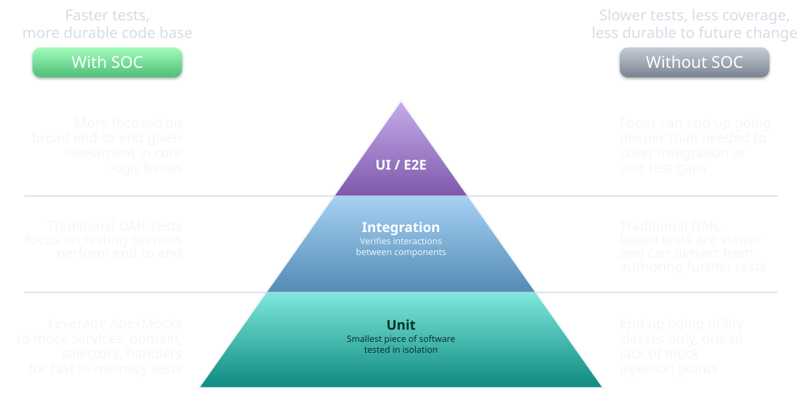
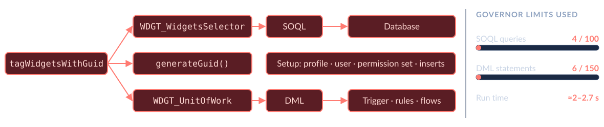
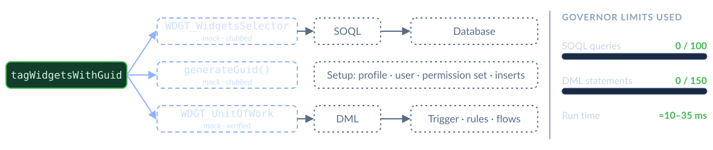
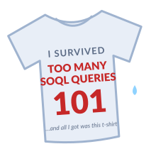

<!-- _class: title-slide -->

# Mocking in Apex
### Why It Changes Everything
#### FFLib Series · Session 005

#### John Storey
###### Staff Software Engineer · Thrivent


<!--
- Sally reads the bio
- Thank Sally, Andy, JD
-->

---

<!-- _class: detail-slide about-slide -->

<div class="about-split">
<div class="about-copy">

# About me

##### Staff Software Engineer | Thrivent | Apex Enterprise Patterns maintainer

* **Apex Enterprise Patterns** — a maintainer of fflib, the library this series is built on
* **FinancialForce roots** — helped build fflib in the mid-2010s, alongside Andy Fawcett, John Daniel ("JD") and others

<!-- -->

* When I'm not working in the IT cloud, I'm flying above the real ones as a general aviation pilot.

</div>
<div class="about-aside">
<div class="about-logo-wrap">

</div>
<a class="about-book">

</a>
</div>
</div>

<!--
- Brief: bio just read
-->

---

<!-- _class: detail-slide series-slide -->

# FFLib Series

<table>
<thead>
<tr><th></th><th>Session</th></tr>
</thead>
<tbody>
<tr class="done"><td><span class="check">✅</span></td><td>Session #1 — Separation of Concerns in Apex: Why Your Future Self Will Thank You</td></tr>
<tr class="done"><td><span class="check">✅</span></td><td>Session #2 — Service Layers Explained: Coordinating Business Logic in Apex</td></tr>
<tr class="done"><td><span class="check">✅</span></td><td>Session #3 — Domain vs Service: Where Should Your Apex Logic Live?</td></tr>
<tr class="done"><td><span class="check">✅</span></td><td>Session #4 — Query Logic as a First-Class Architecture Concern</td></tr>
<tr class="current"><td><span class="check"></span></td><td>Session #5 — Mocking in Apex: Why It Changes Everything · Oct 20</td></tr>
<tr><td><span class="check"></span></td><td>Session #6 — Enterprise-Scale Apex Across Multiple Packages · John Daniel · Nov 3</td></tr>
</tbody>
</table>

<div class="promises-pane" data-marpit-fragment="1">
<h2>Promises we made</h2>
<ul class="promise-list">
<li><span>Andy, Session 1: <code>newInstance()</code>, not <code>new</code>, "for reasons we'll talk about in the mocking sessions"</span><b>13</b></li>
<li><span>Andy, Session 1: instance methods and top-level classes mock; statics don't</span><b>12</b></li>
<li><span>Andy, Session 1: the Application class is optional</span><b>16</b></li>
<li><span>Andy, Session 2: mocking the Unit of Work, skipped "for another session"</span><b>23–24</b></li>
<li><span>John Daniel, Session 3: the Domain's static mock, "the hook… in the fifth episode"</span><b>14</b></li>
<li><span>John Storey, Session 4: can mocking handle statics? And why <code>virtual</code>?</span><b>12, 15</b></li>
</ul>
</div>

<!--
- Session 5 of 6
- #6 John Daniel: packages, AT4DX, Nov 3
- Click: promises we made
- Ticked as we go; recap at close
-->

---

<!-- _class: detail-slide code-slide compact-code-slide -->

# Meet the Widgets

* **`WDGT_Widget__c`** — an auto-number Name, plus `WDGT_Guid__c` and `WDGT_MightBeRequired__c`
* **One Service method, three collaborators** — a Selector, a GUID generator, and a Unit of Work
* **The `WDGT_` prefix** — a namespace inside one package; remember it for Session 6

<div class="vscode">
<div class="vscode-tabs"><span class="vscode-tab vscode-tab-service">WDGT_WidgetsService.cls</span></div>

```apex
public virtual void tagWidgetsWithGuid(Set<Id> widgetsIdSet) {
  if (widgetsIdSet == null || widgetsIdSet.isEmpty()) {
    return;
  }
  try {
    fflib_SObjectUnitOfWork uow = WDGT_UnitOfWork.newInstance();               // Unit of Work
    for (WDGT_Widget__c widget : widgetSelector.selectById(widgetsIdSet)) {  // Selector
      widget.WDGT_Guid__c = widgetsUtility.generateGuid();                     // GUID generator
      uow.registerDirty(new WDGT_Widget__c(Id = widget.Id, WDGT_Guid__c = widget.WDGT_Guid__c));
    }
    uow.commitWork();
  } catch (Exception e) {
    throw wrap(e);
  }
}
```

</div>

<!--
- Small, ours, slide-sized
- Select → GUID → register → commit
- Plus trigger, thin handler
- Warehouse returns in Act IV
-->

---

<!-- _class: detail-slide code-slide compact-code-slide tall-code-slide -->

# What's wrong with this test?

<div class="vscode">
<div class="vscode-tabs"><span class="vscode-tab vscode-tab-alt">WDGT_UnitOfWorkTest.cls</span></div>

```apex
@IsTest
private static void tagWidgetsWithGuid_WHEN_twoWidgetsSaved_EXPECT_eachSavedWithUniqueGuid() {
  User widgetUser = newWidgetUser();     // query a profile, insert a user, assign a permission set
  System.runAs(widgetUser) {
    List<WDGT_Widget__c> widgets = new List<WDGT_Widget__c>{
      new WDGT_Widget__c(), new WDGT_Widget__c()
    };
    insert widgets;
    Set<Id> widgetIds = new Map<Id, WDGT_Widget__c>(widgets).keySet();

    WDGT_WidgetsService.newInstance().tagWidgetsWithGuid(widgetIds);

    List<WDGT_Widget__c> saved = [
      SELECT Id, WDGT_Guid__c FROM WDGT_Widget__c WHERE Id IN :widgetIds
    ];
    Assert.areEqual(32, saved[0].WDGT_Guid__c?.length(), '…');
    Assert.areEqual(32, saved[1].WDGT_Guid__c?.length(), '…');
    Assert.areNotEqual(saved[0].WDGT_Guid__c, saved[1].WDGT_Guid__c, '…');
  }
}
```

</div>

<ul class="points">
<li data-marpit-fragment="1"><b>Setup is about the org, not the method</b> — a user, a permission set, saved records: none of it is tagging</li>
<li data-marpit-fragment="2"><b>Slow</b> — ≈2–2.7 s, 4 SOQL, 6 DML; mocked: ≈10–35 ms, none</li>
<li data-marpit-fragment="3"><b>Can't check the GUIDs</b> — they're random: only "32 characters, and different"</li>
<li data-marpit-fragment="4"><b>Fragile</b> — an unrelated validation rule breaks it</li>
<li data-marpit-fragment="5"><b>Tests <code>generateGuid()</code> too</b> — logic calling logic</li>
<li data-marpit-fragment="6"><b>Proves the database works</b> — Salesforce's job, not ours</li>
</ul>

<p class="practice">💡 Coverage isn't quality.</p>

<!--
- Real, passing, in the repo
- Click: six gripes
- Optional: activate WDGT_MightBeRequired, rerun
- Mocked & inert stay green
- Goal: only this method
-->

---

<!-- _class: detail-slide blast-slide -->

# Test only the method in front of you

<figure class="blast-vignette">

<figcaption>Unit band: Andy, Session 1</figcaption>
</figure>

<div class="blast-row">
<p class="blast-caption">❌ <b>The DML test</b> — an integration test pretending to be a unit test</p>

</div>

<div class="blast-row" data-marpit-fragment="1">
<p class="blast-caption">✅ <b>The mocked test</b> — only the method runs; everything it calls is a mock</p>

<p class="quiet-note">…and a Widget is a tiny object with no automation. Every trigger, flow and related record grows the top row.</p>
</div>

<!--
- Top: what the DML test touched
- Click: what it should touch
- Real limits hit: triggers, flows, data
- Andy's unit band = bottom row
- "We're only human…"
-->

---

<!-- _class: detail-slide longway-slide -->

# The long way to a one-line method

<p class="longway-sub">An illustrative test, not from the repo: to test <code>Invoice.isOverdue()</code>, the test first walks a real record through its whole life.</p>

<div class="longway">
<div class="lw-card" data-marpit-fragment="1">
<p class="lw-state"><span class="lw-step">1</span>Draft</p>
<p class="lw-act">insert Account, Contact, Product, Pricebook, Order</p>
<ul class="lw-chips"><li>AccountTrigger</li><li>ContactTrigger</li><li>OrderTrigger</li><li>OrdersService</li><li>AccountsSelector</li><li>Territory flow</li><li>ProductsSelector</li><li>Duplicate rule</li></ul>
<div class="lw-meters">
<p class="lw-m m-lo"><span>SOQL 14/100</span><i style="width:14%"></i></p>
<p class="lw-m m-lo"><span>DML 9/150</span><i style="width:6%"></i></p>
<p class="lw-m m-lo"><span>CPU 1.1/10 s</span><i style="width:11%"></i></p>
<p class="lw-m m-lo"><span>Heap 0.6/6 MB</span><i style="width:10%"></i></p>
</div></div>
<div class="lw-card" data-marpit-fragment="2">
<p class="lw-state"><span class="lw-step">2</span>Submitted</p>
<p class="lw-act">update Status</p>
<ul class="lw-chips"><li>OrdersHandler</li><li>Orders.validate</li><li>CreditCheckService</li><li>Approval flow</li><li>UsersSelector</li><li>Sharing recalc</li><li>OrdersSelector</li></ul>
<div class="lw-meters">
<p class="lw-m m-lo"><span>SOQL 27/100</span><i style="width:27%"></i></p>
<p class="lw-m m-lo"><span>DML 22/150</span><i style="width:15%"></i></p>
<p class="lw-m m-lo"><span>CPU 2.4/10 s</span><i style="width:24%"></i></p>
<p class="lw-m m-lo"><span>Heap 1.3/6 MB</span><i style="width:22%"></i></p>
</div></div>
<div class="lw-card" data-marpit-fragment="3">
<p class="lw-state"><span class="lw-step">3</span>Approved</p>
<p class="lw-act">approve, notify</p>
<ul class="lw-chips"><li>ApprovalService</li><li>NotificationService</li><li>TaskTrigger</li><li>QueuesSelector</li><li>Escalation flow</li><li>EmailService</li><li>Validation rules ×4</li><li class="lw-team">＋ Commissions</li><li class="lw-team">＋ Partner sync</li></ul>
<p class="lw-team lw-team-tag">Another team, last sprint:<br><b>+12 SOQL, +9 DML</b></p>
<div class="lw-meters">
<p class="lw-m m-lo"><span>SOQL 41/100</span><i style="width:41%"></i></p>
<p class="lw-m m-lo"><span>DML 46/150</span><i style="width:31%"></i></p>
<p class="lw-m m-lo"><span>CPU 3.9/10 s</span><i style="width:39%"></i></p>
<p class="lw-m m-lo"><span>Heap 2.2/6 MB</span><i style="width:37%"></i></p>
</div></div>
<div class="lw-card" data-marpit-fragment="4">
<p class="lw-state"><span class="lw-step">4</span>Fulfilled</p>
<p class="lw-act">reserve stock, book a carrier</p>
<ul class="lw-chips"><li>InventoryService</li><li>OrderLinesSelector</li><li>ShipmentTrigger</li><li>Allocations.reserve</li><li>StockSelector</li><li>Carriers.book</li><li>Platform event</li></ul>
<div class="lw-meters">
<p class="lw-m m-mid"><span>SOQL 58/100</span><i style="width:58%"></i></p>
<p class="lw-m m-mid"><span>DML 78/150</span><i style="width:52%"></i></p>
<p class="lw-m m-mid"><span>CPU 5.3/10 s</span><i style="width:53%"></i></p>
<p class="lw-m m-mid"><span>Heap 3.1/6 MB</span><i style="width:52%"></i></p>
</div></div>
<div class="lw-card" data-marpit-fragment="5">
<p class="lw-state"><span class="lw-step">5</span>Shipped</p>
<p class="lw-act">tracking, customer case</p>
<ul class="lw-chips"><li>ShippingService</li><li>Tracking flow</li><li>CaseTrigger</li><li>CasesSelector</li><li>Milestone flow</li><li>ContactsSelector</li><li>AccountTrigger ↺</li></ul>
<div class="lw-meters">
<p class="lw-m m-mid"><span>SOQL 73/100</span><i style="width:73%"></i></p>
<p class="lw-m m-mid"><span>DML 104/150</span><i style="width:69%"></i></p>
<p class="lw-m m-mid"><span>CPU 6.6/10 s</span><i style="width:66%"></i></p>
<p class="lw-m m-mid"><span>Heap 4.0/6 MB</span><i style="width:67%"></i></p>
</div></div>
<div class="lw-card" data-marpit-fragment="6">
<p class="lw-state"><span class="lw-step">6</span>Invoiced</p>
<p class="lw-act">invoice, lines, tax, roll-ups</p>
<ul class="lw-chips"><li>InvoicingService</li><li>InvoiceTrigger</li><li>InvoiceLineTrigger</li><li>TaxService</li><li>Roll-up flow</li><li>InvoicesSelector</li><li>OrderTrigger ↺</li></ul>
<div class="lw-meters">
<p class="lw-m m-hi"><span>SOQL 89/100</span><i style="width:89%"></i></p>
<p class="lw-m m-hi"><span>DML 131/150</span><i style="width:87%"></i></p>
<p class="lw-m m-hi"><span>CPU 8.1/10 s</span><i style="width:81%"></i></p>
<p class="lw-m m-hi"><span>Heap 4.9/6 MB</span><i style="width:82%"></i></p>
</div>
<div class="lw-fail lw-fail-at"><b>✖ Test failed</b><code>System.<br>LimitException:<br>Too many SOQL<br>queries: 101</code></div>
</div>
<div class="lw-card lw-target" data-marpit-fragment="7">
<p class="lw-state"><span class="lw-step">7</span>Finally: the test</p>
<pre class="lw-code"><code>Boolean isOverdue(Date today) {
  return status == 'Invoiced'
    &amp;&amp; dueDate &lt; today;
}</code></pre>
<p class="lw-act">The one line we wanted to test</p>
<p class="lw-tally"><b>40+</b> classes, flows and rules ran<br><b>1</b> line was tested</p>
<div class="lw-meters">
<p class="lw-m m-hi"><span>SOQL 94/100</span><i style="width:94%"></i></p>
<p class="lw-m m-hi"><span>DML 141/150</span><i style="width:94%"></i></p>
<p class="lw-m m-hi"><span>CPU 8.7/10 s</span><i style="width:87%"></i></p>
<p class="lw-m m-hi"><span>Heap 5.4/6 MB</span><i style="width:90%"></i></p>
</div>
<div class="lw-fail lw-fail-never"><b>Never reached</b>Nothing changed here, or in Invoiced. The change was in Approved.</div>
</div>
</div>

<span class="lw-trigger lw-t1" data-marpit-fragment="8"></span><span class="lw-trigger lw-t2" data-marpit-fragment="9"></span>

<p class="practice lw-punch" data-marpit-fragment="10">Mocked: one <code>Invoice__c</code> in memory. <b>0 SOQL, 0 DML, milliseconds</b>, and no other team's change can break it.</p>



<!--
- Illustrative, not our code
- Clicks 1–7: the pile-up
- 8–9: their change, our failure
- 10: mocked; 11: t-shirt
- Been here; got the t-shirt
-->

---

<!-- _class: detail-slide promises-slide -->

# Stubs, mocks, and fakes

* **Stub** — canned method returns: `when(...).thenReturn(...)`
* **Mock** — a stand-in class that records its calls for the test to verify, with Mockito-style methods: `verify`, matchers
* **Fake** — a working stand-in: `WDGT_InertDml` saves nothing, but remembers what it would have saved

<p class="practice">One ApexMocks object does both: it stubs answers and records calls.</p>

<!--
- Don't sweat the words
- Fake → slide 22 (InertDml)
- Both → slide 16
-->

---

<!-- _class: detail-slide table-slide -->

# Three special cases

Coverage isn't quality, but some things just need coverage: the 0.01%.

| Case | Why it's special | How we cover it |
|---|---|---|
| **Selectors** | All about SOQL | Call each select method with empty parameters<br>`WDGT_WidgetsSelectorTest` |
| **Unit of Work** | All about DML | Inject an inert IDML, register some things, and commit<br>`WDGT_InertDml` |
| **Triggers** | Only run because of DML; must have more than 0% coverage to deploy | Make the trigger handler inert, then save something<br>`WDGT_WidgetsTriggerHandlerTest`<br>⚠️ Beware validation rules, flows, and other automation |

<!--
- Code on slides 20–23
- Empty params: valid SOQL
- Trigger: one save, handler off
-->

---

<!-- _class: detail-slide code-slide compact-code-slide -->

# The Stub API, briefly

* **A platform feature, tests only** (GA in Spring '17): `Test.createStub(Type, System.StubProvider)` returns an object of that type
* **One hook:** every call on it lands in your provider's `handleMethodCall`; whatever that returns, the caller gets
* **Nothing else built in:** no `when`, no `verify`, no matchers. That's what ApexMocks adds

<div class="vscode">
<div class="vscode-tabs"><span class="vscode-tab vscode-tab-alt">A hand-written stub (illustrative)</span></div>

```apex
private class GuidStub implements System.StubProvider {
  public Object handleMethodCall(Object stubbedObject, String stubbedMethodName, Type returnType,
      List<Type> listOfParamTypes, List<String> listOfParamNames, List<Object> listOfArgs) {
    return stubbedMethodName == 'generateGuid' ? '11111111111111111111111111111111' : null;
  }
}

WDGT_WidgetsUtility utility =
  (WDGT_WidgetsUtility) Test.createStub(WDGT_WidgetsUtility.class, new GuidStub());
utility.generateGuid();   // '11111111111111111111111111111111'
```

</div>

<!--
- Platform, not a library
- One method, every call
- fflib-apex-common's own tests do this
-->

---

<!-- _class: detail-slide code-slide compact-code-slide split-slide -->

# How ApexMocks uses the Stub API

<div class="split">
<div class="vscode">
<div class="vscode-tabs"><span class="vscode-tab vscode-tab-alt">fflib_ApexMocks.cls (trimmed)</span></div>

```apex
public with sharing class fflib_ApexMocks
    implements System.StubProvider {

  public Object mock(Type classToMock) {
    return Test.createStub(classToMock, this);
  }

  public Object handleMethodCall(Object stubbedObject,
      String stubbedMethodName, Type returnType,
      List<Type> listOfParamTypes,
      List<String> listOfParamNames,
      List<Object> listOfArgs) {
    return mockNonVoidMethod(stubbedObject,
        stubbedMethodName, listOfParamTypes, listOfArgs);
  }

  public Object mockNonVoidMethod(...) {
    // type + method + parameter types + arguments
    if (this.verifying) {
      verifyMethodCall(invocation);
    } else if (Stubbing) {
      prepareMethodReturnValue(invocation);
    } else {
      recordMethod(invocation);
      return returnValue(invocation);
    }
    return null;
  }
}
```

</div>
<div class="split-side">

**Your test, as ApexMocks sees it**

**Creating the mock:** `mocks.mock(X.class)` asks the Stub API for a stand-in `X`. From now on, every call on it goes to ApexMocks.

**Given: you stub** (between `startStubbing()` and `stopStubbing()`). Calls on the mock aren't real here: they tell ApexMocks what to answer later. `when(mock.method(args)).thenReturn(value)`

**When: your code runs.** Each call on the mock is remembered, and gets back the answer you stubbed, or `null` if there isn't one.

**Then: you verify.** After `verify(mock)`, the next call is a check, not a real call: "was this called, with these arguments?"

*Answers and checks match the method and its exact arguments. Matchers loosen that (slide 19).*

</div>
</div>

<!--
- Real source, trimmed
- mock(): one line
- Three modes, one method
- Key: method + args
-->

---

<!-- _class: detail-slide table-slide -->

# What the Stub API can't stub

| It can't stub… | So we write… |
|---|---|
| **Static methods**, including `@future` | Instance methods: Services are instances, created with `newInstance()` |
| **Inner classes** | Top-level classes for anything we'll mock |
| **A class with only private constructors** | A public constructor; `newInstance()` calls it |
| **Private methods, properties** | Public methods for collaborators; a mock never runs its constructor (slide 25) |
| **System types, triggers, `Batchable` classes** | Our own wrapper, mocked instead: `generateGuid()` wraps `UUID.randomUUID()` |
| **Classes in another namespace** | Mocks created in the class's own namespace |

<p class="promise-tag">✅ Andy, Session 1: instance methods, top-level classes · ✅ Session 4: statics? No.</p>

<!--
- Limits → our rules
- Session 4 wobble: settled, no
- Wrapper: Widgets' GUID
-->

---

<!-- _class: detail-slide code-slide compact-code-slide -->

# One way in, one way to customize

<div class="vscode">
<div class="vscode-tabs"><span class="vscode-tab vscode-tab-service">WDGT_WidgetsService.cls</span></div>

```apex
public static WDGT_WidgetsService newInstance() {              // one way in: live collaborators
  return new WDGT_WidgetsService(
    WDGT_WidgetsSelector.newInstance(),
    WDGT_WidgetsUtility.newInstance()
  );
}

public WDGT_WidgetsService(WDGT_WidgetsSelector widgetSelector,   // one way to customize
                           WDGT_WidgetsUtility widgetsUtility) {
  this.widgetSelector = widgetSelector;
  this.widgetsUtility = widgetsUtility;
}
```

</div>

<div class="vscode">
<div class="vscode-tabs"><span class="vscode-tab vscode-tab-alt">Callers</span></div>

```apex
// app code
WDGT_WidgetsService.newInstance().tagWidgetsWithGuid(widgetIds);
// unit test
new WDGT_WidgetsService(selectorMock, utilityMock).tagWidgetsWithGuid(widgetIds);
```

</div>

<p class="practice">💡 Inject mocks through the constructor, so a test has no hidden setup.</p>
<p class="promise-tag">✅ Andy, Session 1: <code>newInstance()</code>, not <code>new</code></p>

<!--
- newInstance: canonical
- Constructor: customized instance
- Tests: mocks go here
- UoW? Not here: next slide
-->

---

<!-- _class: detail-slide code-slide duo-slide stateful-slide -->

# Stateful objects: substitute where they're created

<ul class="stateful-lead">
<li><b>Some objects carry state.</b> A Domain wraps the records it was given; a Unit of Work collects changes until it commits.</li>
<li><b>They're created mid-method,</b> from records that only exist at that point, so a constructor shouldn't hand one in ahead of time.</li>
<li><b>So we swap them where they're made:</b> their <code>newInstance()</code> returns the test's mock when one is set.</li>
</ul>

<div class="duo">
<div class="duo-col">
<p class="dev-caption">Unit of Work: <code>WDGT_UnitOfWork.cls</code></p>
<div class="vscode">

```apex
@TestVisible
private static fflib_SObjectUnitOfWork mock;

public static fflib_SObjectUnitOfWork newInstance() {
  if (mock != null) {
    return mock;
  }
  return new fflib_SObjectUnitOfWork(
    new List<SObjectType>{ WDGT_Widget__c.SObjectType },
    new fflib_SObjectUnitOfWork.UserModeDML()
  );
}

// In a test
WDGT_UnitOfWork.mock = uowMock;
```

</div>
</div>
<div class="duo-col">
<p class="dev-caption">Domain, from the Warehouse app: <code>Robots.cls</code></p>
<div class="vscode">

```apex
@TestVisible
private static Robots mock;

public static Robots newInstance(List<Robot__c> recordList) {
  return mock != null ? mock : new Robots(recordList);
}

// In a test
Robots.mock = robotsMock;
```

</div>
</div>
</div>

<blockquote class="slide-quote">"Domains and UnitOfWork still use property injection – as they are stateful (domain within a method, uow's within a service method)" <cite>Andy Fawcett, sample PR #61, Sept 2026</cite></blockquote>

<p class="promise-tag">✅ John Daniel, Session 3: "the hook… in the fifth episode"</p>

<!--
- Created mid-method
- Static mock = test hook
- Domains: tested directly (27)
- UoW: mocked or inert (23–24)
-->

---

<!-- _class: detail-slide promises-slide checklist-mock-slide -->

# Mockability ☑️ checklist

* ☑️ **A non-private constructor**
* ☑️ **A top-level class**
* ☑️ **Instance methods** for anything you'll stub
* ☑️ **Nothing private** you need to stub
* ✖️ **`virtual`: not needed for Apex mocking**, unlike some other stacks. Use it only when you need inheritance

<p class="promise-tag">✅ Session 4: "maybe we could ping Andy about why he likes virtual"</p>

<!--
- Four checks, that's all
- virtual: removed it, mocks still worked
-->

---

<!-- _class: detail-slide promises-slide dense-bullets-slide -->

# Where fflib is heading: mainstream DI

* **A static factory plus constructor injection** — `newInstance()` by default, constructors for customized instances: the same shape as Spring, .NET, or any Mockito-era stack
* **Interfaces only where implementations genuinely vary** — the refreshed sample keeps just `ISupportInvoicing`; the Widgets code has none
* **The Application class is optional**
* **AT4DX keeps a factory, on purpose** — across packages, the caller can't name the class that does the work: another package supplies it through custom metadata, maybe installed later or overriding another. So the caller asks a factory for an interface, resolved at run time; tests still `setMock()` it. More in Session 6

<blockquote class="slide-quote">"Having an Application class is not a requirement to use FFLib; it depends on your needs, particularly regarding dependency injection." <cite>Andy Fawcett, andyinthecloud.com, April 2026</cite></blockquote>

<p class="promise-tag">✅ Andy, Session 1: the Application class is optional</p>

<!--
- Mainstream shape
- Interfaces: when they vary
- WDGT_ prefix → Session 6
-->

---

<!-- _class: detail-slide timeline-slide -->

# How fflib mocking evolved

<ol class="timeline">
<li><b>Generated mocks</b><span>ApexMocks generated mock classes, for interfaces only. So interfaces went everywhere</span></li>
<li><b>The Stub API arrives</b><span>Mocks are created at run time, for classes too. Code generation fades away</span></li>
<li><b>The Application factory</b><span>Interfaces plus a central factory, and <code>setMock</code> to swap implementations</span></li>
<li class="now"><b>Today</b><span>Concrete classes, <code>newInstance()</code> plus constructors, interfaces only where they vary</span></li>
<li class="next"><b>Next: multi-package</b><span>AT4DX: the same seam, with metadata deciding (Session 6)</span></li>
</ol>

<p class="practice">Interfaces everywhere and an Application factory? Not wrong; just from an earlier stage.</p>

<!--
- No dates: stages
- Common no longer needs Mocks
- I removed the generator docs
-->


---

<!-- _class: detail-slide code-slide compact-code-slide tall-code-slide -->

# ApexMocks: the three you'll use daily

* **① `thenReturn`** — what a call answers
* **② `thenReturnMulti`** — one answer per call, in order
* **③ `verify`** — the call happened, with these arguments

<div class="vscode">
<div class="vscode-tabs"><span class="vscode-tab vscode-tab-alt">WDGT_UnitOfWorkTest.cls — the mocked test</span></div>

```apex
// Given
fflib_ApexMocks mocks = new fflib_ApexMocks();
WDGT_WidgetsSelector selectorMock = (WDGT_WidgetsSelector) mocks.mock(WDGT_WidgetsSelector.class);
WDGT_WidgetsUtility utilityMock = (WDGT_WidgetsUtility) mocks.mock(WDGT_WidgetsUtility.class);
fflib_SObjectUnitOfWork uowMock = (fflib_SObjectUnitOfWork) mocks.mock(fflib_SObjectUnitOfWork.class);
mocks.startStubbing();
mocks.when(selectorMock.selectById(widgetIds)).thenReturn(new List<WDGT_Widget__c>{ first, second }); // ①
mocks.when(utilityMock.generateGuid()).thenReturnMulti(new List<Object>{ firstGuid, secondGuid });     // ②
mocks.stopStubbing();
WDGT_UnitOfWork.mock = uowMock;

// When
new WDGT_WidgetsService(selectorMock, utilityMock).tagWidgetsWithGuid(widgetIds);

// Then
((fflib_SObjectUnitOfWork) mocks.verify(uowMock))                                                   // ③
  .registerDirty(new WDGT_Widget__c(Id = first.Id, WDGT_Guid__c = firstGuid));
((fflib_SObjectUnitOfWork) mocks.verify(uowMock))
  .registerDirty(new WDGT_Widget__c(Id = second.Id, WDGT_Guid__c = secondGuid));
((fflib_SObjectUnitOfWork) mocks.verify(uowMock, 1)).commitWork();
```

</div>

<p class="practice">💡 Exact first: SObject equality proves the right GUID <em>and</em> nothing beyond Id and GUID.</p>

<!--
- Mockito heritage, concrete classes
- Verify = cast, then call
- Assert class, with messages
-->

---

<!-- _class: detail-slide code-slide bake-slide -->

# More than one way to bake a cake

<p class="bake-lead">Slide 18's <b>Then</b>, three more ways. Same Given and When; real tests in <code>WDGT_UnitOfWorkTest</code>.</p>

<div class="bake">
<div class="bake-col">
<p class="bake-cap"><b>Matchers and a count</b><br>when you can't be exact</p>
<div class="vscode">

```apex
((fflib_SObjectUnitOfWork)
  mocks.verify(uowMock, 2))
  .registerDirty(
    fflib_Match.anySObject());

((fflib_SObjectUnitOfWork)
  mocks.verify(uowMock))
  .registerDirty(
    fflib_Match.sObjectWith(
      new Map<SObjectField, Object>{
        WDGT_Widget__c.Id => first.Id,
        WDGT_Widget__c.WDGT_Guid__c
          => firstGuid
      }));
```

</div>
</div>
<div class="bake-col">
<p class="bake-cap"><b>Argument captor</b><br>when you want to look at what was passed</p>
<div class="vscode">

```apex
fflib_ArgumentCaptor captor =
  fflib_ArgumentCaptor.forClass(
    WDGT_Widget__c.class);

((fflib_SObjectUnitOfWork)
  mocks.verify(uowMock, 2))
  .registerDirty(
    (SObject) captor.capture());

List<Object> registered =
  captor.getAllValues();
Assert.areEqual(firstGuid,
  ((WDGT_Widget__c) registered[0])
    .WDGT_Guid__c, '…');
```

</div>
</div>
<div class="bake-col">
<p class="bake-cap"><b>In order</b><br>when order is the logic</p>
<div class="vscode">

```apex
fflib_InOrder inOrder =
  mocks.inOrder(
    new List<Object>{ uowMock });

((fflib_SObjectUnitOfWork)
  inOrder.verify(uowMock,
    mocks.calls(2)))
  .registerDirty(
    fflib_Match.anySObject());

((fflib_SObjectUnitOfWork)
  inOrder.verify(uowMock,
    mocks.calls(1)))
  .commitWork();
```

</div>
</div>
</div>

<p class="quiet-note">A matcher returns a typed placeholder (<code>null</code>) and waits on the side, so generic ones need a cast, and a call's arguments are all matchers or none.</p>

<figure class="cat-sticker">

<figcaption>No cats were harmed in the making of these tests.</figcaption>
</figure>

<!--
- Exact first; these when it doesn't fit
- sObjectWith: only listed fields
- Captor ≈ inert DML, mock side
- Commit-before-register passes plain verify
- Love your kitties
-->

---

<!-- _class: detail-slide refcard-slide -->

# ApexMocks reference card

<div class="refcard">
<div>
<h3>Stubbing</h3>
<ul>
<li><code>when(…).thenReturn(v)</code></li>
<li><code>thenReturnMulti(list)</code> — consecutive calls</li>
<li><code>thenThrow(e)</code>, <code>thenThrowMulti(list)</code></li>
<li><code>thenAnswer(fflib_Answer)</code> — computed from the arguments</li>
<li>Void methods: <code>doThrowWhen(e, mock)</code>, <code>doAnswer(answer, mock)</code></li>
</ul>
<h3>Verifying</h3>
<ul>
<li><code>verify(mock)</code> = once; <code>verify(mock, n)</code>; <code>fflib_ApexMocks.NEVER</code></li>
<li><code>times(n)</code>, <code>never()</code>, <code>atLeast(n)</code>, <code>atMost(n)</code>, <code>atLeastOnce()</code>, <code>between(a, b)</code></li>
<li><code>.description('…')</code> — your own failure message</li>
<li><code>inOrder(…)</code> with <code>calls(n)</code>, <code>verifyNoMoreInteractions()</code>, <code>verifyNoInteractions()</code></li>
<li><code>fflib_ArgumentCaptor</code>: <code>capture()</code>, <code>getValue()</code>, <code>getAllValues()</code></li>
</ul>
</div>
<div>
<h3>Matchers <span>(<code>fflib_Match</code>; all or nothing per call)</span></h3>
<ul>
<li><b>Any:</b> <code>anyString</code>, <code>anyId</code>, <code>anySObject</code>, <code>anyObject</code>, …</li>
<li><b>Equality:</b> <code>eq</code>, <code>eqId</code>, <code>refEq</code>, <code>isNull</code>, <code>isNotNull</code></li>
<li><b>SObjects:</b> <code>sObjectWith(fieldMap)</code>, <code>sObjectWithId</code>, <code>sObjectWithName</code>, <code>sObjectOfType</code>, <code>sObjectsWith</code></li>
<li><b>Strings, lists:</b> <code>stringContains</code>, <code>stringStartsWith</code>, <code>stringMatches</code>, <code>listContains</code>, <code>listIsEmpty</code></li>
<li><b>Ranges, dates:</b> <code>integerBetween</code>, <code>decimalMoreThan</code>, <code>dateAfter</code>, <code>datetimeBetween</code></li>
<li><b>Combining:</b> <code>allOf</code>, <code>anyOf</code>, <code>noneOf</code>, <code>isNot</code></li>
<li><b>Your own:</b> implement <code>fflib_IMatcher</code></li>
</ul>
<h3>Further reading</h3>
<ul class="refcard-links">
<li>Mockito's method reference: javadoc.io/doc/org.mockito/mockito-core/latest/org/mockito/Mockito.html</li>
<li>ApexMocks: github.com/apex-enterprise-patterns/fflib-apex-mocks (README, "Documentation")</li>
</ul>
</div>
</div>

<!--
- Reference, not read
- Mockito for Apex
- All in fflib_ApexMocks, fflib_Match
-->

---

<!-- _class: detail-slide code-slide compact-code-slide -->

# Building records in memory

<div class="vscode">
<div class="vscode-tabs"><span class="vscode-tab vscode-tab-alt">Test setup, no DML (snippets)</span></div>

```apex
// A fake Id: valid-looking, no insert
WDGT_Widget__c widget = new WDGT_Widget__c(
  Id = fflib_IDGenerator.generate(WDGT_Widget__c.SObjectType)
);

// Read-only fields (auto-number Name, formulas, roll-ups): set them through JSON
widget = (WDGT_Widget__c) fflib_ApexMocksUtils.setReadOnlyFields(
  widget, WDGT_Widget__c.class,
  new Map<SObjectField, Object>{ WDGT_Widget__c.Name => 'Widget_000000001' }
);

// A parent: set the relationship field directly (as the Warehouse tests do)
line.FulfillmentOrder__r = order;

// Children: makeRelationship builds parents with their child lists
List<Account> accounts = (List<Account>) fflib_ApexMocksUtils.makeRelationship(
  List<Account>.class, new List<Account>{ account },
  Contact.AccountId, new List<List<Contact>>{ contacts }
);
```

</div>

<p class="practice">💡 Build records in memory, not in the database. Never <code>SeeAllData</code>.</p>

<!--
- Fake Id: no insert
- Warehouse: TestIdGenerator, same idea
- Read-only: JSON round trip
-->

---

<!-- _class: detail-slide code-slide duo-slide selector-test-slide -->

# Testing Selectors

<ul class="slide-lead">
<li><b>Callers mock them, so the quality lives in the callers' tests.</b> The Selector's own test is mostly for coverage (slide 9): empty conditions, no data, no DML. As a bonus, it proves the SOQL is valid.</li>
<li><b>No early return.</b> Convert null to empty and let the query run. Not intuitive, but a guard skips the query: no coverage, unchecked SOQL. It costs one query of your 100, and about 2 ms. Null <em>must</em> be converted: it throws in fflib's dynamic SOQL.</li>
</ul>

<div class="duo">
<div class="duo-col">
<p class="dev-caption">The Selector and its test</p>
<div class="vscode">

```apex
public virtual List<WDGT_Widget__c> selectById(Set<Id> idSet) {
  idSet = (idSet != null) ? idSet : new Set<Id>();
  return (List<WDGT_Widget__c>) selectSObjectsById(idSet);
}

// WDGT_WidgetsSelectorTest
Integer fromEmpty = selector.selectById(new Set<Id>()).size();
Integer fromNull = selector.selectById(null).size();
Assert.areEqual(0, fromEmpty, 'Empty Ids: no widgets');
Assert.areEqual(0, fromNull, 'Null Ids: no widgets');
```

</div>
</div>
<div class="duo-col">
<p class="dev-caption">⚠️ What a mocked Selector hides</p>
<div class="vscode">

```apex
// The Selector doesn't query WDGT_MightBeRequired__c.
// A real row throws when logic reads it:
//   SObjectException: SObject row was retrieved via
//   SOQL without querying the requested field
String fromReal = selected.WDGT_MightBeRequired__c;

// A mocked Selector returns what the test built,
// so the same read works ('Present') and the gap hides:
String fromMock =
  selectorMock.selectById(ids)[0].WDGT_MightBeRequired__c;
```

</div>
</div>
</div>

<p class="practice">💡 Test our logic, not Salesforce's. E2E test automation catches the field gap.</p>

<!--
- Null throws in dynamic SOQL
- Demonstration test, both halves
- Don't contort unit tests for it
- Name methods for their shape
-->

---

<!-- _class: detail-slide table-slide uow-test-slide -->

# Testing the Unit of Work

| If… | Use | Assert with |
|---|---|---|
| **You don't care about the resulting records** | A fully mocked Unit of Work (ApexMocks) | `verify(uowMock).registerDirty(…)`, `commitWork()`, or capture the records (slide 19) |
| **You want to inspect what would have been saved** | A real Unit of Work with an inert IDML (`WDGT_InertDml`, next slide) | `Assert` on `inertDml.inserted` / `updated` / `deleted` |

<div class="calls-outcome">
<div class="co-panel co-calls">
<p class="co-head">Mocked Unit of Work + verify or captor<br><b>sees the calls</b></p>
<dl>
<dt>Asks</dt><dd>"Which <code>register*</code> method, with which records?"</dd>
<dt>Tied to</dt><dd>The exact method and overload</dd>
<dt>Breaks when</dt><dd><code>registerDirty</code> → <code>registerUpsert</code>, or one record → a list, <em>even with the same result</em></dd>
</dl>
</div>
<div class="co-panel co-outcome">
<p class="co-head">Real Unit of Work + inert IDML<br><b>sees the outcome</b></p>
<dl>
<dt>Asks</dt><dd>"What would have been saved?"</dd>
<dt>Tied to</dt><dd>Nothing about how it was registered</dd>
<dt>Breaks when</dt><dd>Only when the result changes. Also runs the real commit logic</dd>
</dl>
</div>
</div>

<p class="promise-tag">✅ Andy, Session 2: mocking the Unit of Work, "for another session"</p>

<!--
- Decision rule first
- Both in WDGT_UnitOfWorkTest
- Don't test fflib's UoW
- Coverage: inert IDML, register, commit
-->

---

<!-- _class: detail-slide code-slide duo-slide inert-slide -->

# InertDml: assert what would have been saved

<ul class="slide-lead">
<li><b>The real Unit of Work runs its full commit logic,</b> but the IDML <em>collects</em> the records instead of saving them.</li>
</ul>

<div class="duo">
<div class="duo-col">
<p class="dev-caption"><code>WDGT_InertDml.cls</code> (trimmed)</p>
<div class="vscode">

```apex
@IsTest
public class WDGT_InertDml implements
    fflib_SObjectUnitOfWork.IDML,
    fflib_SObjectUnitOfWork.IDMLUpsertable {
  public List<SObject> inserted = new List<SObject>();
  public List<SObject> updated = new List<SObject>();
  // … upserted, deleted, published, emptied

  public void dmlInsert(List<SObject> objList) {
    inserted.addAll(objList);
  }
  public void dmlUpdate(List<SObject> objList) {
    updated.addAll(objList);
  }
  // … one method per kind of DML
  public void dmlDelete(List<SObject> objList) {
    deleted.addAll(objList);
  }
}
```

</div>
</div>
<div class="duo-col">
<p class="dev-caption">The inert test</p>
<div class="vscode">

```apex
// Given: stubbed Selector and GUIDs, as before, plus
WDGT_InertDml inertDml = new WDGT_InertDml();
WDGT_UnitOfWork.mock = new fflib_SObjectUnitOfWork(
  new List<SObjectType>{ WDGT_Widget__c.SObjectType },
  inertDml
);

// When
new WDGT_WidgetsService(selectorMock, utilityMock)
  .tagWidgetsWithGuid(widgetIds);

// Then: the records that would have been saved
WDGT_Widget__c firstUpdated =
  (WDGT_Widget__c) inertDml.updated[0];
Assert.areEqual(firstGuid,
  firstUpdated.WDGT_Guid__c, '…');
Assert.isTrue(inertDml.inserted.isEmpty(), '…');
```

</div>
</div>
</div>

<div class="many-objects">
<p class="many-head"><b>Real services touch many objects.</b> The inert IDML gives inserted records fake Ids, so links resolve, and hands back one type at a time.</p>
<div class="vscode">

```apex
uow.registerNew(acme);
uow.registerNew(coyote, Contact.AccountId, acme);
uow.commitWork();
// without fake Ids, every link is null
Contact saved = (Contact) inertDml.getInserted(Contact.SObjectType)[0];
Assert.areEqual(acme.Id, saved.AccountId, '…');
```

</div>
</div>

<p class="practice">💡 <code>verify</code> checks that a call happened; the inert IDML checks the outcome, so it doesn't care which <code>register*</code> call produced it.</p>

<!--
- Built for Session 4, handed off; now grown up
- fflib copies parent Ids just before each insert
- Commit still sets a savepoint: 1 DML
- From WDGT_InertDmlTest
-->

---

<!-- _class: detail-slide code-slide duo-slide trigger-test-slide -->

# Testing triggers

<ul class="slide-lead">
<li><b>Keep the trigger a one-line handoff and the handler thin:</b> it converts trigger specifics to general Apex and calls other logic. Unit-test that logic where it lives.</li>
<li><b>Coverage only:</b> switch the handler off with fflib's own switch, then save one record. The trigger and the handler's construction are covered; no handler logic runs.</li>
</ul>

<div class="duo">
<div class="duo-col">
<p class="dev-caption"><code>WDGT_Widgets.trigger</code></p>
<div class="vscode">

```apex
trigger WDGT_Widgets on WDGT_Widget__c (
    before insert, before update,
    after insert, after update) {
  fflib_SObjectDomain.triggerHandler(
    WDGT_WidgetsTriggerHandler.class
  );
}
```

</div>
</div>
<div class="duo-col">
<p class="dev-caption"><code>WDGT_WidgetsTriggerHandlerTest.cls</code></p>
<div class="vscode">

```apex
// Given every trigger event for the handler is off
fflib_SObjectDomain
  .getTriggerEvent(WDGT_WidgetsTriggerHandler.class)
  .disableAll();

// When a widget is saved
Database.SaveResult result =
  Database.insert(new WDGT_Widget__c());

// Then it saves
Assert.isTrue(result.isSuccess(), '…');
```

</div>
</div>
</div>

<p class="practice">⚠️ <code>disableAll()</code> mutes only our handler. <b>The save is real:</b> populate what the org requires (required fields, validation rules), and expect flows and other automation to run.</p>

<!--
- The 0.01%
- Why not a mock: Configuration null
- Activate WDGT_MightBeRequired: it fails
-->

---

<!-- _class: detail-slide code-slide compact-code-slide tall-code-slide scale-slide -->

# The same patterns at real scale

* **The Warehouse app's `DispatchServiceTest`** — Selectors in through the constructor; Domains and the Unit of Work through their static mocks (slide 14)

<div class="vscode">
<div class="vscode-tabs"><span class="vscode-tab vscode-tab-alt">DispatchServiceTest.cls (inherited, trimmed)</span></div>

```apex
// Given: three Selectors, three Domains and a Unit of Work, all mocks; records in memory, fake Ids
mocks.startStubbing();
mocks.when(lineSelectorMock.selectPendingUnassignedByWarehouseWithOrder(warehouseIds))
  .thenReturn(new List<FulfillmentLine__c>{ line });
mocks.when(robotSelectorMock.selectIdleByWarehouseWithModel(warehouseIds))
  .thenReturn(new List<Robot__c>{ robot });
mocks.when(robotsMock.getAvailableForWork())                  // logic calling logic
  .thenReturn(new List<Robot__c>{ robot });
mocks.when(orderSelectorMock.selectById(new Set<Id>{ orderId }))
  .thenReturn(new List<FulfillmentOrder__c>{ order });
mocks.stopStubbing();
Robots.mock = robotsMock;
FulfillmentLines.mock = linesMock;
FulfillmentOrders.mock = ordersMock;
UnitOfWork.mock = uowMock;

// When
new DispatchService(lineSelectorMock, robotSelectorMock, orderSelectorMock)
  .dispatchWarehouses(warehouseIds);

// Then
((Robots) mocks.verify(robotsMock)).startWork(uowMock);
((FulfillmentLines) mocks.verify(linesMock)).assign(
  (Map<Id, Id>) fflib_Match.anyObject(), (fflib_SObjectUnitOfWork) fflib_Match.eq(uowMock)
);
((FulfillmentOrders) mocks.verify(ordersMock)).markInProgress(uowMock);
((fflib_SObjectUnitOfWork) mocks.verify(uowMock, 1)).commitWork();
```

</div>

<p class="practice">💡 One behaviour per test, with a name that says what it does: <code>method_WHEN_condition_EXPECT_result</code>.</p>

<!--
- Same seams, bigger method
- getAvailableForWork ≈ generateGuid
- anyObject + eq: all or nothing
-->

---

<!-- _class: detail-slide code-slide split-slide domain-test-slide -->

# A Domain test: in memory, mock only what it calls out to

<div class="split">
<div class="vscode">
<div class="vscode-tabs"><span class="vscode-tab vscode-tab-domain">RobotsTest.cls (inherited)</span></div>

```apex
// Given robots at each published due rule, plus one already in service
Robot__c intervalDue = newRobot(Robots.STATUS_IDLE, Robots.HEALTH_HEALTHY, 0, 80);
intervalDue.HoursSinceService__c = 40;
intervalDue.Model__r = new RobotModel__c(ServiceIntervalHours__c = 40);
Robot__c critical = newRobot(Robots.STATUS_IDLE, Robots.HEALTH_CRITICAL, 81, 80);
Robot__c wearDue = newRobot(Robots.STATUS_IDLE, Robots.HEALTH_WARNING, 90, 80);
Robot__c inService = newRobot(Robots.STATUS_IN_SERVICE, Robots.HEALTH_CRITICAL, 100, 80);
inService.HoursSinceService__c = 40;
Robot__c healthy = newRobot(Robots.STATUS_IDLE, Robots.HEALTH_HEALTHY, 0, 80);

// When due robots are collected
Set<Robot__c> due = Robots.newInstance(
    new List<Robot__c>{ intervalDue, critical, wearDue, inService, healthy }
  )
  .getDueForService();

// Then interval, Critical, and 90% wear are due; InService and Healthy are not
System.assertEquals(true, due.contains(intervalDue), 'Interval hours should be due');
// … three more
System.assertEquals(false, due.contains(healthy), 'Healthy idle robot should not be due');
```

</div>
<div class="split-side">

**A Domain's logic runs on records built in memory,** usually with nothing to mock: no DML, no SOQL, no mocks.

**But mock what it calls out to,** the same rule as everywhere:

- **Values a test can't predict:** a Domain that needs a new GUID mocks the GUID generator, as the Widgets tests do
- **Dates:** if the method itself uses today, pass the date in through the constructor; if another class works out the next business day, mock that call. Weekends and holidays stop mattering
- **Logic outside the Domain that does a lot of work:** mock it away

**Test the method. Mock the rest.**

<p class="quiet-note">Inherited test; new tests use the <code>Assert</code> class.</p>

</div>
</div>

<!--
- Contrast with slide 26
- Fake Ids, Model__r set directly
- Fine-grained only: a GUID, never a payment callout
- Mock the calendar: order from chaos
-->

---

<!-- _class: detail-slide table-slide layers-mock-slide callers-table-slide -->

# What to mock at each layer

<table>
<thead><tr><th>Layer</th><th>Its test checks</th><th>Mock</th></tr></thead>
<tbody>
<tr><td><span class="layer-pill layer-pill-client">Controller</span></td><td>What it passes in, and what it shows</td><td>The Service</td></tr>
<tr><td><span class="layer-pill layer-pill-service">Service</span></td><td>How it orchestrates</td><td>Selectors, Domains, the Unit of Work, logic classes (<code>WDGT_WidgetsUtility</code>)</td></tr>
<tr><td><span class="layer-pill layer-pill-domain">Domain</span></td><td>Its rules, on in-memory records</td><td>Only what it calls out to (slide 27)</td></tr>
<tr><td><span class="layer-pill layer-pill-selector">Selector</span></td><td>That its query is valid</td><td>Nothing: empty conditions (slide 22)</td></tr>
<tr><td><span class="layer-pill layer-pill-handler">Trigger</span></td><td>Coverage only</td><td>Nothing: the handler switched off, one save (slide 25)</td></tr>
</tbody>
</table>

<p class="practice">💡 Each layer's test checks only its own decisions.</p>

<!--
- Same seams, every layer
- Only the trigger touches the DB
-->

---

<!-- _class: detail-slide pitfalls-slide -->

# Pitfalls and gotchas

<div class="pitfalls">
<div>
<h3>Test design</h3>
<ul>
<li><b>Over-verifying:</b> asserting every call tests the implementation, not the behaviour</li>
<li><b>Mocks that return mocks:</b> a sign the method knows too much</li>
<li><b>Verifying your own stub:</b> stub a Selector, call it, verify it. That tests nothing</li>
<li><b>Unrealistic stubs:</b> a Selector throws a <code>QueryException</code>, never a <code>DmlException</code>. A hand-made <code>DmlException</code> has no row data. Fix the stub, never the business logic</li>
</ul>
</div>
<div>
<h3>ApexMocks gotchas</h3>
<ul>
<li><b>Forgetting <code>stopStubbing()</code>:</b> every later call becomes a stub</li>
<li><b>SObject arguments match by equality:</b> every field. Use matchers when you can't be exact</li>
<li><b>Mocks of the same type share stubs</b> by default (<code>HasIndependentMocks</code>)</li>
<li><b>Matchers are all or nothing</b> per call; use <code>isNull()</code>, not <code>eq(null)</code></li>
<li><b>One <code>fflib_ApexMocks</code> per test</b></li>
</ul>
</div>
</div>

<div class="pitfall-band">
<p><b>⚠️ Tests that depend on DML break when the org changes, not the code:</b> a new validation rule, flow or required field. Mocked and inert tests stay green.</p>
<p><b>⚠️ Mocked Selectors hide field gaps:</b> expected; integration and E2E testing catch them (slide 22).</p>
</div>

<!--
- Optional live: activate WDGT_MightBeRequired
- DML tests fail; mocked stay green
- Deactivate after
-->

---

<!-- _class: detail-slide takeaway-slide -->

<blockquote class="takeaway">Test the method. Mock the rest.</blockquote>

<div class="takeaway-cols">
<div>
<h3>Promises kept</h3>
<ul class="kept">
<li>✅ <code>newInstance()</code>, not <code>new</code> <span>Andy, S1</span></li>
<li>✅ Instance methods, top-level classes <span>Andy, S1</span></li>
<li>✅ The Application class is optional <span>Andy, S1</span></li>
<li>✅ Mocking the Unit of Work <span>Andy, S2</span></li>
<li>✅ The Domain's static mock hook <span>John Daniel, S3</span></li>
<li>✅ Statics, and <code>virtual</code> <span>Session 4</span></li>
</ul>
</div>
<div class="next-up">
<h3>What's next</h3>
<p><b>Session #6 — Enterprise-Scale Apex Across Multiple Packages</b></p>
<p>John Daniel · packages and AT4DX · Nov 3</p>
<p class="next-why">The same seams, with metadata from any package deciding what you get.</p>
</div>
</div>

<!--
- One line to remember
- All promises paid
- Hand to JD: Nov 3
-->

---

<!-- _class: title-slide -->

# Thank you!

#### John Storey · Code With Sally
### FFLib Series · Session 005


<!--
- Thank Sally, Andy, JD
- Questions
-->
