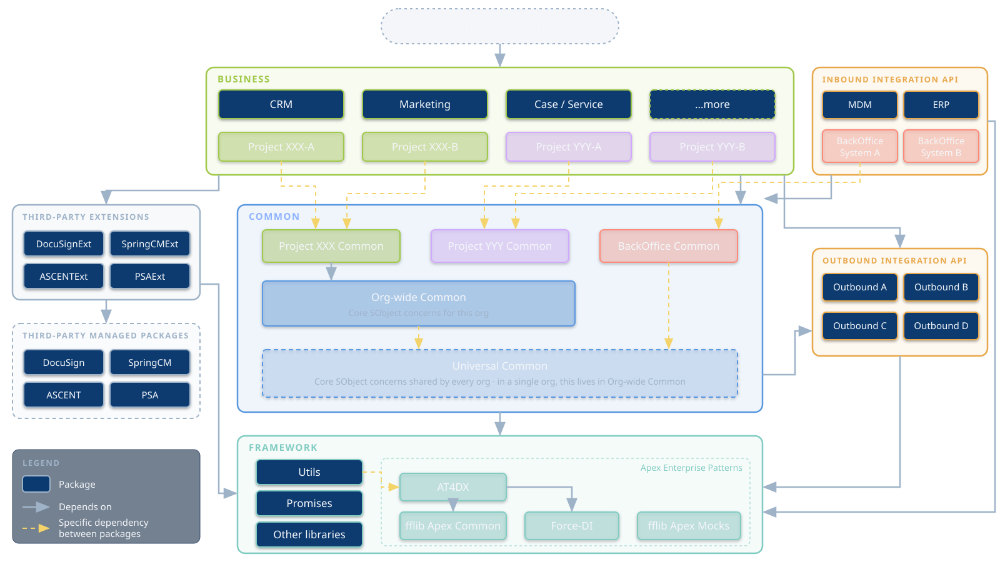
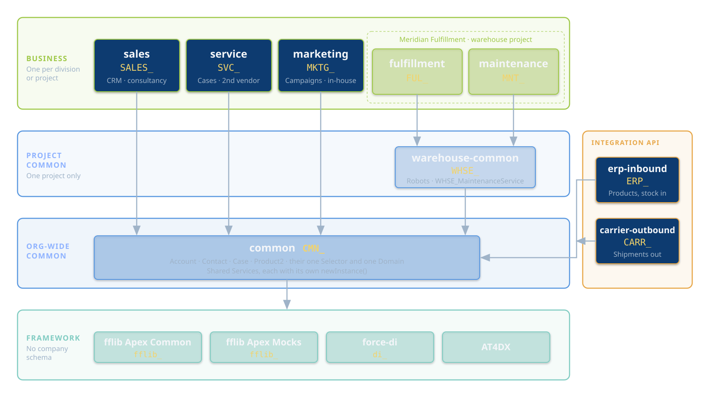
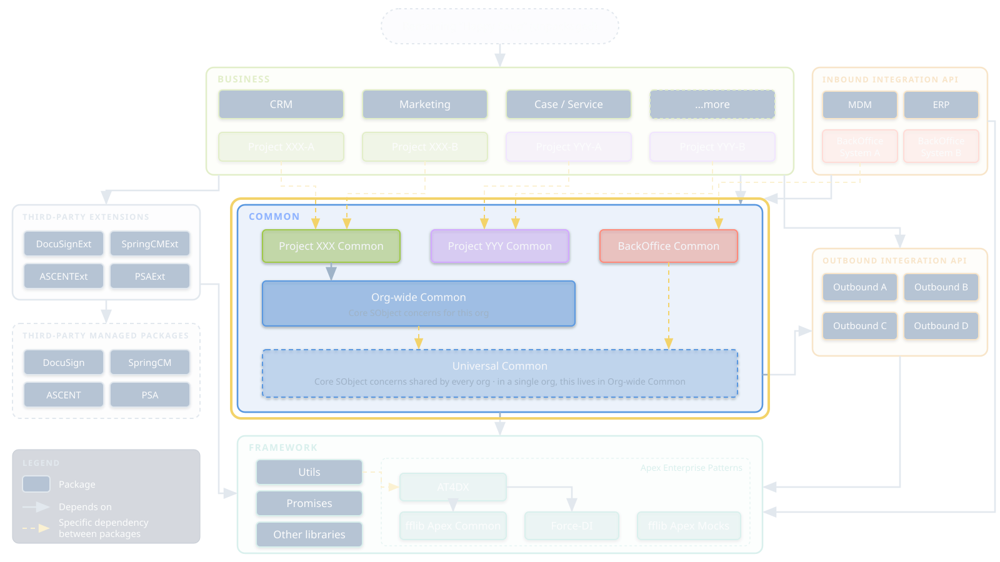
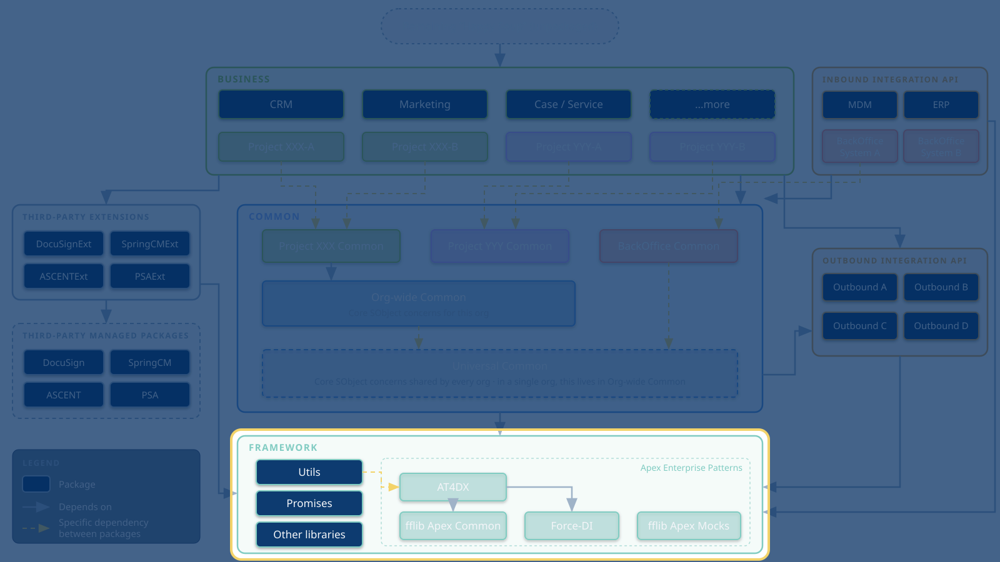
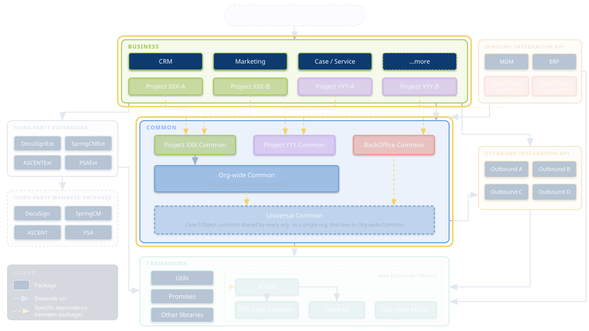

<!-- _class: title-slide -->

# Enterprise-Scale Apex Across Multiple Packages
### Contracts, configuration and extensibility
#### FFLib Series · Session 006

#### John M. Daniel
###### Senior Director, Digital Platforms · Steampunk, Inc.


<!--
- Sally reads the bio
- Thank Sally, Andy, John Storey
- Last of six
-->

---

<!-- _class: detail-slide about-slide -->

<div class="about-split">
<div class="about-copy">

# About me

##### Senior Director of Digital Platforms, Steampunk, Inc. | Apex Enterprise Patterns Maintainer & Architect

* **Apex Enterprise Patterns (fflib) maintainer & architect** — steward of `fflib-apex-common`, `fflib-apex-mocks`, `force-di`, and `AT4DX` at github.com/apex-enterprise-patterns
* **Open source education** — promoting awareness and adoption of Domain, Service, and Selector patterns for enterprise Salesforce development
* **Senior Director, Digital Platforms** — leading Salesforce platform engineering standards and delivery at Steampunk, Inc.

<!-- -->

* When I am not working on Apex architecture, I am probably driving my Jeep on the beach.

</div>
<div class="about-aside">
<a class="about-book">

</a>
</div>
</div>

<!--
- Brief: bio just read
-->

---

<!-- _class: detail-slide series-slide -->

# FFLib Series

<table>
<thead>
<tr><th></th><th>Session</th></tr>
</thead>
<tbody>
<tr class="done"><td><span class="check">✅</span></td><td>Session #1 — Separation of Concerns in Apex: Why Your Future Self Will Thank You</td></tr>
<tr class="done"><td><span class="check">✅</span></td><td>Session #2 — Service Layers Explained: Coordinating Business Logic in Apex</td></tr>
<tr class="done"><td><span class="check">✅</span></td><td>Session #3 — Domain vs Service: Where Should Your Apex Logic Live?</td></tr>
<tr class="done"><td><span class="check">✅</span></td><td>Session #4 — Query Logic as a First-Class Architecture Concern</td></tr>
<tr class="done"><td><span class="check">✅</span></td><td>Session #5 — Mocking in Apex: Why It Changes Everything</td></tr>
<tr class="current"><td><span class="check"></span></td><td>Session #6 — Enterprise-Scale Apex Across Multiple Packages · Nov 3</td></tr>
</tbody>
</table>

<div class="promises-pane" data-marpit-fragment="1">
<h2>Promises we made</h2>
<ul class="promise-list">
<li><span>Andy, Session 2: metadata-driven dependency injection, and interfaces to resolve Services</span><b>19, 24</b></li>
<li><span>Session 4: AT4DX adds fields to a Selector from another package (field sets)</span><b>30</b></li>
<li><span>Session 4: <code>@NamespaceAccessible</code></span><b>16</b></li>
<li><span>Session 5: the <code>WDGT_</code> prefix, "a namespace inside one package"</span><b>16</b></li>
<li><span>Session 5: "AT4DX keeps a factory, on purpose"</span><b>23</b></li>
</ul>
</div>

<!--
- 1: SoC. 2: Service, UoW
- 3 (mine): Domain vs Service
- 4: Selectors. 5: mocking, newInstance()
- Click: promises for today
- Ticked as we go; recap at close
-->

---

<!-- _class: detail-slide promises-slide -->

# One package so far

<p class="tagline">Today the same layers split across packages</p>

- **Sessions 1 to 5 lived in one package:** `force-app`. Every class could see every other class
- **Service, Domain, Selector and Unit of Work** don't change today. Where they live does
- **Session 5's seams** — `newInstance()`, constructors, mocks — are what make the split possible

<p class="practice">Same patterns. Different boxes. The boxes are packages.</p>

<!--
- Nothing to unlearn
- Seams from S5 carry the weight
-->

---

<!-- _class: detail-slide checklist-slide -->

# Today

<ul class="checklist">
<li>Today</li>
<li>Meridian: one org, four divisions<span class="check"></span></li>
<li>The package layers<span class="check"></span></li>
<li>Cross-package architecture<span class="check"></span></li>
<li>Shared contracts and interfaces<span class="check"></span></li>
<li>Configuration-driven design<span class="check"></span></li>
<li>Extensibility patterns<span class="check"></span></li>
</ul>

<!--
- Story first, then the map
- Four abstract topics on the map
- Q&A at the end; ask any time
-->

---

<!-- _class: detail-slide cards-slide -->

# Meet Meridian Corporation

<p class="tagline">An industrial supplier with robot-run warehouses, all on one Salesforce org</p>

<div class="cards">
<div class="card business">
<h3>Sales</h3>
<p>Runs the CRM: opportunities and quotes</p>
<p class="tech">Built with an outside consultancy</p>
</div>
<div class="card business">
<h3>Service</h3>
<p>Cases, complaints and returns</p>
<p class="tech">Built by a second vendor</p>
</div>
<div class="card business">
<h3>Marketing</h3>
<p>Campaigns and customer engagement</p>
<p class="tech">A small in-house team</p>
</div>
<div class="card gold">
<h3>Meridian Fulfillment</h3>
<p>The Warehouse Operations app: North Hub and its robots</p>
<p class="tech">The app from Sessions 2 to 5</p>
</div>
</div>

<div class="band-note">
<p>For years it worked, because nobody's code touched anyone else's.</p>
</div>

<!--
- Zoom out from the warehouse
- Warehouse = one of four divisions
- Each built its own way
-->

---

<!-- _class: detail-slide cards-slide -->

# Then the divisions need each other

<p class="tagline">And the org starts turning into Happy Soup</p>

<div class="cards cols-3">
<div class="card business">
<h3>Sales → Fulfillment</h3>
<p>A closed deal should create a fulfillment order</p>
</div>
<div class="card business">
<h3>Service → Fulfillment</h3>
<p>Tell a customer where their order is</p>
</div>
<div class="card business">
<h3>Marketing → everyone</h3>
<p>Its fields on every Account query</p>
</div>
</div>

<div class="band-note" data-marpit-fragment="1">
<p><b>⚠️ Four teams edit the same Account trigger and the same Account Selector.</b></p>
<p><b>⚠️ Every release needs everyone.</b> One vendor's change breaks another vendor's tests.</p>
</div>

<!--
- Real asks, all reasonable
- Click: shared trigger, shared Selector
- Releases lock together
-->

---

<!-- _class: detail-slide quote-slide -->

# Leadership's question

<blockquote>
How do the divisions work together without wiring themselves so tightly that every change ripples through all of them?
</blockquote>

<p class="quote-source">The question from today's abstract</p>

<!--
- Rest of the talk answers it
- Short answer at the end
-->

---

<!-- _class: detail-slide diagram-slide map-slide -->

# The package layers



<!--
- Anchor slide; we come back here
- Top: Happy Soup, shrinking
- Business: one per division/project
- Common: project, org-wide, universal
- Framework: fflib, force-di, AT4DX
- Sides: integration, third-party extensions
- Arrows only point down
-->

---

<!-- _class: detail-slide table-slide dense-table-slide -->

# What lives in each layer

<p class="tagline">Top to bottom</p>

| Layer | What lives here | Rule |
|---|---|---|
| **Remaining "Happy Soup"** | Metadata not yet packaged | Shrinks over time; depends on everything below it |
| **Business** | One package per division or project: CRM, Service, Marketing, project packages | Owns its own objects, fields and processes. Never depends on another business package |
| **Project Common** | Shared by one project's business packages | Exists only when two or more business packages need the same thing |
| **Org-wide Common** | Core SObject concerns for this org | Owns the shared objects and their one Selector and one Domain |
| **Universal Common** | Core SObject concerns common to all of the company's orgs | Multi-org only. In a single org, its contents live in Org-wide Common |
| **Framework** | fflib Apex Common and Apex Mocks, force-di, AT4DX, utils | No company schema at all |

<p class="practice">Beside the stack: integration API packages on common, and third-party extension packages on managed packages.</p>

<!--
- Read the Rule column
- Happy Soup is honest: it exists
- Framework knows no company schema
-->

---

<!-- _class: detail-slide rules-slide -->

# Three rules

<ol class="rules">
<li><div><b>Dependencies only point down</b><span>A lower layer never names anything in a higher one</span></div></li>
<li><div><b>Each object has one owner</b><span>The lowest layer that needs it owns it. Higher layers extend it through injection, not by editing it</span></div></li>
<li><div><b>Push shared things down only as far as needed</b><span>Two business packages share something? It goes in their Project Common, not Org-wide Common</span></div></li>
</ol>

<!--
- Repeat these all night
- Rule 3 keeps common small
-->

---

<!-- _class: detail-slide diagram-slide map-slide -->

# Meridian on the map



<!--
- Four divisions, five business packages
- Warehouse is its own project
- warehouse-common: robots, warehouses
- common: Account, Contact, Case, Product2
- Integrations on common
- Every package has a prefix
-->

---

<!-- _class: detail-slide promises-slide -->

# One org, or many

<p class="tagline">Meridian is a single-org story. The pattern doesn't change with more orgs</p>

- **Single org:** anything that would live in Universal Common goes into that org's Org-wide Common package
- **Several orgs:** it moves down into a Universal Common package, prefix `UCMN_`, that every org installs
- **Everything above it is the same:** business packages, Project Common, contracts and bindings

<p class="practice">Start in one org. If a second org arrives, move shared pieces down a layer.</p>

<!--
- Same map, one more layer
- No rewrite to go multi-org
-->

---

<!-- _class: detail-slide cards-slide -->

# 1 · Cross-package architecture

<p class="tagline">FFLib's layers already give you the boundaries. Packages make the platform enforce them</p>

<div class="cards cols-3">
<div class="card business">
<h3>Why split at all</h3>
<ul>
<li>Teams ship on different schedules</li>
<li>The org is too big for one deploy</li>
<li>Some features belong to one division or region</li>
</ul>
</div>
<div class="card common">
<h3>What unlocked packages give you</h3>
<ul>
<li>Each team gets its own version, tests and release</li>
<li>The platform checks the dependencies</li>
<li>Ownership is visible, not tribal knowledge</li>
</ul>
</div>
<div class="card framework">
<h3>Where FFLib lands</h3>
<ul>
<li><b>Framework:</b> fflib, force-di, AT4DX</li>
<li><b>Common:</b> shared objects with their Selector and Domain, and shared Services</li>
<li><b>Business:</b> its own Domains, Selectors, Services, registered through custom metadata</li>
</ul>
</div>
</div>

<!--
- Topic 1 is the map itself
- Boundaries existed since S1
- Packages make them real
-->

---

<!-- _class: detail-slide promises-slide -->

# Dependencies only point down

<p class="tagline">The rule that forces everything else today</p>

- **`common` can never name a class in `sales` or `fulfillment`.** It doesn't compile, because it can't see them
- **`sales` can't name a class in `fulfillment` either.** Business packages never depend on each other
- **So when a lower package needs work done above it, it can't call it directly.** It has to ask something for it

<p class="practice">If you can't call it, you ask for it. Topics 2 to 4 are the ways to ask.</p>

<!--
- Compiler enforces this, not reviews
- "Ask for it": contract, factory, metadata
-->

---

<!-- _class: detail-slide promises-slide -->

# Package prefixes, not namespaces

<p class="tagline">Framed for an enterprise: 2GP unlocked packages, no namespace</p>

- **Each package gets a prefix:** 3 to 8 capital letters, an underscore, then the element's proper name
- **`SALES_OpportunitiesService`, `SVC_SLATier__c`, `WHSE_Robot__c`:** the prefix says which package owns it
- **Session 5's `WDGT_` prefix was a package prefix inside one package.** Today every package gets one

<p class="practice">Namespaces and <code>@NamespaceAccessible</code> are for ISVs building managed packages. The AEP frameworks support that too; it's not today's case.</p>

<p class="promise-tag">✅ Session 5: the <code>WDGT_</code> prefix · ✅ Session 4: <code>@NamespaceAccessible</code></p>

<!--
- Enterprise default: no namespace
- Prefix in caps: linters want Apex names to start with a capital
- Prefix does the ownership job
- ISV case: one line, move on
-->

---

<!-- _class: detail-slide table-slide -->

# Naming conventions

<p class="tagline">"Let the metadata's API name tell you where it belongs"</p>

A name has two parts: the **prefix** says which package owns it, and the **suffix** says what kind of artifact it is.

| Name | Owner | Artifact |
|---|---|---|
| `SALES_AccountsSelector` | sales | Selector |
| `WHSE_IMaintenanceService` | warehouse-common | Service interface |
| `WHSE_MaintenanceServiceImpl` | warehouse-common | Service implementation |
| `SVC_CaseController` | service | Controller |
| `FUL_FulfillmentRestAPI` | fulfillment | REST API |
| `MKTG_EngagementScore__c` | marketing | Custom field on Account |

<p class="practice">Pays off in code review, in audits, and while code is still moving out of the Happy Soup.</p>

<!--
- Only DevOps point today
- Suffixes: Selector, Service, ServiceImpl, Controller, Test, RestAPI, Invocable
- Reviewer sees owner at a glance
-->

---

<!-- _class: detail-slide diagram-slide map-slide map-tagline-slide -->

# 2 · Shared contracts and interfaces

<p class="tagline">Shared Services live in a lower layer, so business packages use them without depending on each other</p>



<!--
- Highlight: Common
- Service triad: one package
- Callers use its newInstance()
-->

---

<!-- _class: detail-slide promises-slide -->

# Interfaces return, on purpose

<p class="tagline">Session 5 saved this case for today</p>

- **Session 5:** use interfaces "only where implementations genuinely vary"
- **Across packages, they can vary:** a higher package can swap in its own implementation with a binding
- **Each Service ships as a triad in one package:** the facade, the interface and the implementation
- **Callers use the facade's `newInstance()`,** and only ever hold the interface. They never name the implementation

<p class="practice">Andy, Session 2: interfaces are how Services get resolved. Here's where it matters.</p>

<p class="promise-tag">✅ Andy, Session 2: interfaces to resolve Services</p>

<!--
- Not "interfaces everywhere"
- Triad stays together
- Swap = binding, not a fork
-->

---

<!-- _class: detail-slide cards-slide -->

# One Service, three classes, one package

<p class="tagline">Selectors and Domains follow the same rule</p>

<div class="cards cols-3">
<div class="card common">
<h3>Ships together</h3>
<ul>
<li><code>WHSE_MaintenanceService</code>: the facade, with a static <code>newInstance()</code></li>
<li><code>WHSE_IMaintenanceService</code>: the interface, with the records and simple data classes it passes</li>
<li><code>WHSE_MaintenanceServiceImpl</code>, and its binding record</li>
</ul>
</div>
<div class="card warn">
<h3>Every consumer</h3>
<ul>
<li>Calls <code>WHSE_MaintenanceService.newInstance()</code>, from any package</li>
<li>Holds the interface type, never the implementation</li>
<li>Never calls <code>Application.Service</code> itself: only <code>newInstance()</code> does</li>
</ul>
</div>
<div class="card gold">
<h3>Keep it stable</h3>
<ul>
<li>Every change moves every package that calls it</li>
<li>Add methods; avoid changing or removing old ones</li>
<li>Put the triad in the lowest package its callers depend on, and no lower</li>
</ul>
</div>
</div>

<div class="band-note">
<p><b>Selectors and Domains too:</b> each has its own static <code>newInstance()</code>, such as <code>CMN_AccountsSelector.newInstance()</code>, and every consumer calls it.</p>
</div>

<!--
- Facade, interface, impl together
- newInstance() is the only door
- Tests: mock the interface, as in S5
-->

---

<!-- _class: detail-slide code-slide duo-slide s6-duo -->

# Fulfillment calls Maintenance

<p class="tagline">Both warehouse packages need maintenance scheduling, so it moves down to warehouse-common</p>

<div class="duo">
<div class="duo-col">
<p class="dev-caption">FulfillmentService.cls · Sessions 2 to 5</p>
<div class="vscode">

```apex
// One package: it can see MaintenanceService
private final MaintenanceService maintenanceSvc;

public static FulfillmentService newInstance() {
  return new FulfillmentService(
    // ...selectors
    MaintenanceService.newInstance()
  );
}

// Hand due robots to maintenance
maintenanceSvc.scheduleService(dueRobots, uow);
```

</div>
</div>
<div class="duo-col">
<p class="dev-caption">FUL_FulfillmentService.cls · today</p>
<div class="vscode">

```apex
// Scheduling now lives in warehouse-common
private final WHSE_IMaintenanceService maintenanceSvc;

public static FUL_FulfillmentService newInstance() {
  return new FUL_FulfillmentService(
    // ...selectors
    WHSE_MaintenanceService.newInstance()
  );
}

// Same call, through the interface
maintenanceSvc.scheduleService(dueRobots, uow);
```

</div>
</div>
</div>

<!--
- Left: S5 code, unchanged
- Right: still newInstance()
- Field type is the interface
- newInstance() asks the factory
- Fulfillment never names maintenance
-->

---

<!-- _class: detail-slide diagram-slide map-slide map-tagline-slide -->

# 3 · Configuration-driven design

<p class="tagline">How the factory picks an implementation, and lets a higher package replace it</p>



<!--
- Highlight: Framework
- AT4DX factories live here
- Custom metadata does the wiring
-->

---

<!-- _class: detail-slide promises-slide -->

# Why a factory, across packages

<p class="tagline">"AT4DX keeps a factory, on purpose"</p>

- **Session 5's `newInstance()` stays:** every Service, Selector and Domain has one, and every consumer calls it
- **Inside it, AT4DX asks the factory:** `Application.Service.newInstance(WHSE_IMaintenanceService.class)`
- **The factory reads the bindings,** so a higher package can replace the implementation without touching any caller
- **There's no app-specific `Application` class to edit:** AT4DX's `Application` lives in the framework and reads bindings from every installed package

<p class="practice">Callers call <code>newInstance()</code>. It asks the factory. Custom metadata decides the class. Tests still <code>setMock()</code>.</p>

<p class="promise-tag">✅ Session 5: "AT4DX keeps a factory, on purpose"</p>

<!--
- S5's Application: optional in one package
- Across packages: the factory is the point
- Only newInstance() talks to it
- No central list of every class
-->

---

<!-- _class: detail-slide table-slide -->

# Four factories, four bindings

<p class="tagline">Bindings live in custom metadata, and deploy with the package that owns the class</p>

| Factory | Custom metadata | Key fields |
|---|---|---|
| `Application.Selector` | `ApplicationFactory_SelectorBinding__mdt` | `BindingSObject__c`, `To__c`, `Priority__c` |
| `Application.Domain` | `ApplicationFactory_DomainBinding__mdt` | `BindingSObject__c`, `To__c` (a Domain's constructor class) |
| `Application.Service` | `ApplicationFactory_ServiceBinding__mdt` | `BindingInterface__c`, `To__c`, `Priority__c` |
| `Application.UnitOfWork` | `ApplicationFactory_UnitOfWorkBinding__mdt` | `BindingSObject__c`, `BindingSequence__c` |

<p class="practice">Installing a package adds its bindings, and a higher <code>Priority__c</code> replaces one. Under the covers it's force-di: metadata-driven dependency injection.</p>

<p class="promise-tag">✅ Andy, Session 2: metadata-driven dependency injection</p>

<!--
- Same four factories as fflib
- UoW order is now metadata too
- Promise from Andy, S2
-->

---

<!-- _class: detail-slide table-slide binding-slide -->

# A binding record

<p class="tagline">Story: Service asks where an order is</p>

**`fulfillment`** owns order status: `FUL_OrderFulfillmentService`, `FUL_IOrderFulfillmentService` and `FUL_OrderFulfillmentServiceImpl`, plus this record:

| ApplicationFactory_ServiceBinding__mdt | FUL_OrderFulfillmentService |
|---|---|
| BindingInterface__c | `FUL_IOrderFulfillmentService` |
| To__c | `FUL_OrderFulfillmentServiceImpl` |
| Priority__c | 1 |

<p class="practice">service can't depend on fulfillment, so fulfillment ships the "Where's my order?" component for the Case page. service never names a <code>FUL_</code> class.</p>

<!--
- Whole triad in fulfillment
- Component added to Case page
- Record travels with the class
-->

---

<!-- _class: detail-slide code-slide compact-code-slide -->

# Asking the factory

<p class="tagline">Only the facade talks to the factory. Every caller uses <code>newInstance()</code></p>

<div class="vscode">
<div class="vscode-tabs"><span class="vscode-tab vscode-tab-service">FUL_OrderFulfillmentService.cls · fulfillment</span></div>

```apex
public inherited sharing class FUL_OrderFulfillmentService {
  public static FUL_IOrderFulfillmentService newInstance() {
    return (FUL_IOrderFulfillmentService)
      Application.Service.newInstance(FUL_IOrderFulfillmentService.class);
  }
}

// Any consumer, such as the Case page component's controller
List<FUL_OrderStatus> statuses = FUL_OrderFulfillmentService.newInstance()
  .getStatusForAccounts(accountIds);

// In a test, the mock beats any binding (same as Session 5)
Application.Service.setMock(FUL_IOrderFulfillmentService.class, mockService);
```

</div>

<p class="practice" data-marpit-fragment="1">A regional package can ship a higher-priority binding with its own implementation. No caller changes.</p>

<!--
- Facade newInstance() asks factory
- Callers never touch Application
- Click: override by binding
- setMock: S5 story unchanged
-->

---

<!-- _class: detail-slide cards-slide -->

# Overrides, and a caution

<p class="tagline">Configuration is powerful, and it hides the call graph</p>

<div class="cards cols-2">
<div class="card common">
<h3>Overrides without forks</h3>
<ul>
<li>A later package, or a subscriber org, supplies a different binding for the same interface</li>
<li><code>Priority__c</code> decides which one wins</li>
<li>A regional package can replace one Service without touching the original</li>
</ul>
</div>
<div class="card warn">
<h3>Keep it traceable</h3>
<ul>
<li>Name bindings clearly, with the package prefix</li>
<li>Keep one binding per interface unless you mean to override</li>
<li>Add a test that checks every binding resolves</li>
</ul>
</div>
</div>

<!--
- Override = new record, not a fork
- Debugging: "who answers this?"
- Binding test catches typos at deploy
-->

---

<!-- _class: detail-slide diagram-slide map-slide map-tagline-slide -->

# 4 · Extensibility patterns

<p class="tagline">How a higher layer adds fields, queries and logic to objects a lower layer owns</p>



<!--
- Highlight: Business over Common
- Rule 2: one owner, others extend
-->

---

<!-- _class: detail-slide table-slide techniques-slide -->

# Five AT4DX techniques

<p class="tagline">Each FFLib layer has an extension point</p>

| Technique | Extension point | What a higher-layer package adds |
|---|---|---|
| **Application factory injection** | `ApplicationFactory_*Binding__mdt` | Its own Selector, Domain or Service, or an override of one |
| **Selector field injection** | `SelectorConfig_FieldSetInclusion__mdt` | Its own fields on another package's queries, through a field set |
| **Selector method injection** | `selectInjection(...)` on the shared Selector | Its own query against an object a lower layer owns |
| **Domain process injection** | `DomainProcessBinding__mdt`, plus criteria and action classes | Logic inside another package's Domain, in a set order |
| **Platform event distribution** | `PlatformEvents_Subscription__mdt`, plus an `IEventsConsumer` | A subscriber to another package's events |

<!--
- First one: topic 3
- Next four: one story each
-->

---

<!-- _class: detail-slide cards-slide tight-cards-slide -->

# Selector field injection

<p class="tagline">Story: Marketing adds fields to Account</p>

<div class="cards cols-3">
<div class="card common">
<h3>common owns</h3>
<p><code>Account</code> and <code>CMN_AccountsSelector</code>, which extends <code>ApplicationSObjectSelector</code> with <code>includeFieldSetFields</code> on</p>
</div>
<div class="card business">
<h3>marketing ships</h3>
<ul>
<li><code>MKTG_Slogan__c</code>, <code>MKTG_EngagementScore__c</code></li>
<li>A field set: <code>MKTG_AccountFields</code></li>
<li>A <code>SelectorConfig_FieldSetInclusion__mdt</code> record: <code>BindingSObject__c</code> = Account, <code>FieldsetName__c</code> = <code>MKTG_AccountFields</code></li>
</ul>
</div>
<div class="card gold">
<h3>Result</h3>
<p>Every Account query through the Selector comes back with marketing's fields</p>
<p>common never changes</p>
</div>
</div>

<div class="band-note">
<p><b>"The core package never learns that the marketing package exists, yet Account queries come back with the marketing fields."</b></p>
</div>

<p class="promise-tag">✅ Session 4: AT4DX adds fields to a Selector from another package</p>

<!--
- S4 promise: field sets, includeFieldSetFields
- Field set + one record
- Uninstall marketing: fields drop out
-->

---

<!-- _class: detail-slide code-slide compact-code-slide -->

# Selector method injection

<p class="tagline">Story: Service needs accounts with more than five open complaint Cases</p>

<div class="vscode">
<div class="vscode-tabs"><span class="vscode-tab vscode-tab-selector">SVC_AccountsWithOpenComplaintsSelectorMethod.cls · service</span></div>

```apex
public inherited sharing class SVC_AccountsWithOpenComplaintsSelectorMethod
  extends AbstractSelectorMethodInjectable
  implements ISelectorMethodInjectable {

  public List<SObject> selectQuery() {
    Parameters params = (Parameters) getParams();
    Integer minimum = params.minimumOpenComplaints;
    // newQueryFactory() is the shared Selector's: its fields, field sets and security
    return Database.query(newQueryFactory()
      .setCondition('SVC_OpenComplaintCount__c > :minimum').toSOQL());
  }

  public class Parameters implements ISelectorMethodParameterable {
    public Integer minimumOpenComplaints;
  }
}

// The caller, in service
List<Account> accounts = CMN_AccountsSelector.newInstance()
  .selectInjection(SVC_AccountsWithOpenComplaintsSelectorMethod.class, params);
```

</div>

<!--
- Query is service's, not common's
- Uses the shared Selector's fields
- CMN_AccountsSelector untouched
- Count field: a roll-up in service
-->

---

<!-- _class: detail-slide cards-slide tight-cards-slide -->

# Domain process injection

<p class="tagline">Story: Service reacts to a late shipment</p>

<div class="cards cols-3">
<div class="card common">
<h3>common owns</h3>
<p>The <code>Case</code> Domain, extending <code>ApplicationSObjectDomain</code>. Its trigger runs any injected processes for each trigger event</p>
</div>
<div class="card business">
<h3>service ships</h3>
<ul>
<li><b>Criteria:</b> <code>SVC_LateShipmentCriteria</code> (<code>IDomainProcessCriteria</code>) keeps complaint Cases about late orders</li>
<li><b>Action:</b> <code>SVC_FlagAccountAction</code> (<code>IDomainProcessAction</code>) flags their Accounts</li>
</ul>
</div>
<div class="card gold">
<h3>Two <code>DomainProcessBinding__mdt</code> records</h3>
<ul>
<li><code>RelatedDomainBindingSObject__c</code> = Case</li>
<li><code>TriggerOperation__c</code> = After_Insert</li>
<li><code>Type__c</code> = Criteria, then Action</li>
<li><code>OrderOfExecution__c</code> sets the order</li>
</ul>
</div>
</div>

<div class="band-note">
<p><b>Session 3 drew the line between the Domain and the trigger handler.</b> Domain process injection is that same line, opened to other packages.</p>
</div>

<!--
- Criteria filters, action acts
- Order: 1.1 criteria, 1.2 action
- Async, recursion flags exist
- S3 tie-in
-->

---

<!-- _class: detail-slide code-slide duo-slide s6-duo -->

# Platform event distribution

<p class="tagline">Story: Sales closes a deal, and the warehouse ships it</p>

<div class="duo">
<div class="duo-col">
<p class="dev-caption">sales: when an Opportunity closes</p>
<div class="vscode">

```apex
AT4DXMessage__e evt = new AT4DXMessage__e();
evt.Category__c  = 'Opportunity';
evt.EventName__c = 'SALES_OPPORTUNITY_CLOSED_WON';
evt.Payload__c   = JSON.serialize(opportunityIds);
EventBus.publish(evt);
```

</div>
</div>
<div class="duo-col">
<p class="dev-caption">FUL_ClosedWonConsumer.cls · fulfillment</p>
<div class="vscode">

```apex
public class FUL_ClosedWonConsumer
  extends PlatformEventAbstractConsumer {
  public override void runInProcess() {
    Set<Id> oppIds = new Set<Id>();
    for (SObject sobj : events) {
      AT4DXMessage__e evt = (AT4DXMessage__e) sobj;
      oppIds.addAll((Set<Id>) JSON.deserialize(
        evt.Payload__c, Set<Id>.class));
    }
    FUL_FulfillmentOrdersService.newInstance()
      .createFor(oppIds);
  }
}
```

</div>
</div>
</div>

<p class="practice">fulfillment ships a <code>PlatformEvents_Subscription__mdt</code> record: <code>EventBus__c</code>, <code>EventCategory__c</code>, <code>Event__c</code>, <code>Consumer__c</code>. <code>PlatformEventDistributor</code> hands matching events to the consumer.</p>

<!--
- Sales publishes, knows no listener
- Fulfillment subscribes with metadata
- Creates FUL_ FulfillmentOrder
- Event name is the only contract
-->

---

<!-- _class: detail-slide cards-slide -->

# Events decouple the most

<p class="tagline">Pick the lightest tool that does the job</p>

<div class="cards cols-2">
<div class="card business">
<h3>Why events</h3>
<ul>
<li>The publisher doesn't know who listens</li>
<li>No interface to keep stable, only an event name and payload</li>
<li>Add a subscriber by installing a package</li>
</ul>
</div>
<div class="card warn">
<h3>The trade-off</h3>
<ul>
<li>Asynchronous: the deal closes before the order exists</li>
<li>Harder to trace and to debug</li>
<li>Document event names like a contract, because they are one</li>
</ul>
</div>
</div>

<div class="band-note">
<p>Need an answer now? Call the owning Service (topic 2). Telling others something happened? Publish an event.</p>
</div>

<!--
- Answer now: call the Service
- Something happened: event
-->

---

<!-- _class: detail-slide table-slide dense-table-slide stories-table-slide -->

# Meridian's stories, on the map

<p class="tagline">Every division works with the others, and no business package depends on another</p>

| Story | From → to | Technique | Lives in |
|---|---|---|---|
| Sales closes a deal, the warehouse ships it | sales → fulfillment | Platform event distribution | fulfillment |
| Service asks where an order is | fulfillment → Case page | Service triad + binding | fulfillment |
| Fulfillment schedules robot maintenance | fulfillment → warehouse-common | Service triad + binding | warehouse-common |
| Marketing adds fields to Account | marketing → common | Selector field injection | marketing |
| Service reacts to a late shipment | service → common | Domain process injection | service |
| Service queries its own Accounts | service → common | Selector method injection | service |

<!--
- Six arrows, none sideways
- Each owner untouched
-->

---

<!-- _class: detail-slide takeaway-slide -->

<blockquote class="takeaway">Depend on contracts. Let configuration decide.</blockquote>

<div class="takeaway-cols">
<div>
<h3>Promises kept</h3>
<ul class="kept">
<li>✅ Metadata-driven dependency injection <span>Andy, S2</span></li>
<li>✅ Interfaces to resolve Services <span>Andy, S2</span></li>
<li>✅ Selector fields from another package <span>Session 4</span></li>
<li>✅ <code>@NamespaceAccessible</code>: it's for ISVs <span>Session 4</span></li>
<li>✅ <code>WDGT_</code>, across real packages <span>Session 5</span></li>
<li>✅ AT4DX keeps a factory, on purpose <span>Session 5</span></li>
</ul>
</div>
<div class="next-up">
<h3>Remember the map</h3>
<p><b>Dependencies only point down.</b></p>
<p><b>Each object has one owner.</b></p>
<p><b>Push shared things down only as far as needed.</b></p>
<p class="next-why">Thank you, Sally, Andy and John Storey, for the series.</p>
</div>
</div>

<!--
- One line to remember
- All promises paid
- Thank presenters, then Q&A
-->

---

<!-- _class: detail-slide cards-slide -->

# Likely questions

<p class="tagline">Short answers to start from</p>

<div class="cards cols-3">
<div class="card common">
<h3>Do I need AT4DX?</h3>
<p>No. You can pass interfaces and use a small factory of your own. AT4DX pays off once several packages extend the same objects.</p>
</div>
<div class="card common">
<h3>Migrating an org?</h3>
<p>Pull shared objects and Services into common first. Then move one feature at a time, with every call going through <code>newInstance()</code>.</p>
</div>
<div class="card common">
<h3>Is <code>Application</code> required now?</h3>
<p>Session 5 said it's optional in one package. Across packages, the factory is the point.</p>
</div>
<div class="card warn">
<h3>Harder to debug?</h3>
<p>Somewhat. Clear binding names, a test that every binding resolves, and rare overrides.</p>
</div>
<div class="card warn">
<h3>Performance?</h3>
<p>Custom metadata reads don't count against the SOQL limit. Load bindings once per transaction anyway.</p>
</div>
<div class="card warn">
<h3>Namespaces?</h3>
<p>An ISV's concern with managed packages, and supported. Enterprises use unlocked packages and prefixes.</p>
</div>
</div>

<!--
- Backup; open with live Q&A first
-->

---

<!-- _class: detail-slide promises-slide -->

# Learn more

<p class="tagline">Where to go next</p>

- **AT4DX** and **AT4DX sample code** — github.com/apex-enterprise-patterns/at4dx and at4dx-samplecode
- **force-di** — github.com/apex-enterprise-patterns/force-di
- **fflib Apex Common** and **fflib Apex Mocks** — github.com/apex-enterprise-patterns/fflib-apex-common and fflib-apex-mocks
- **Brewtiful Beans Learns AT4DX** — a blog series by **Jake Richter** that walks through the same ideas with a coffee roaster: syntax-syllogism.com/blog/tags/brewtiful-beans
- **This series** — slides for all six sessions: github.com/ImJohnMDaniel/CodeWithSally-Apex-English

<!--
- Thank Jake for Brewtiful Beans
- Repo has every deck
-->

---

<!-- _class: title-slide -->

# Thank you
### Questions?
#### FFLib Series · Session 006

#### John M. Daniel
###### github.com/ImJohnMDaniel


<!--
- Live Q&A
- At 90 min: deeper on layers
-->
